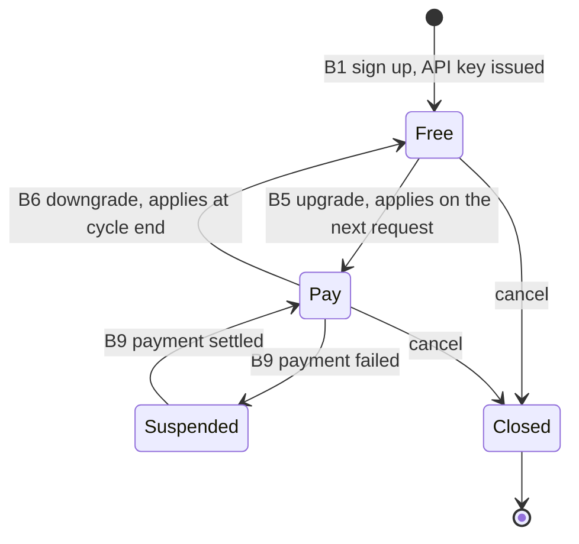
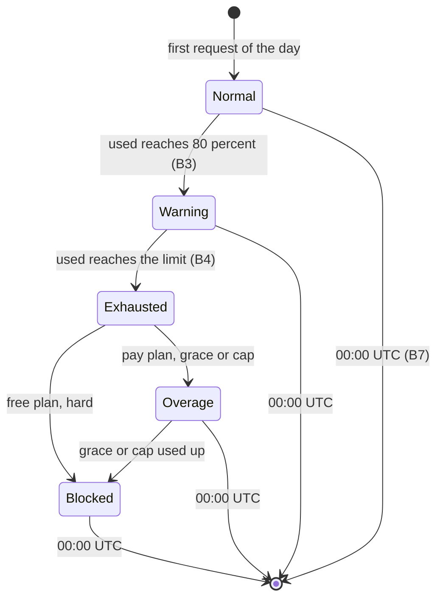

# Customer plan phase (Part B)

> Built across Weeks 2, 4 and 5 · Flow steps B1 to B9 on the Quota Service Flow page · Status: B1 done (missing plan = Free, seeding); B2 limit and remaining from the plan through gRPC; B4 done (three policies, deny cache; Week 4 gate test passes through gRPC); B9 limiter side done (`SUSPENDED`), `rlctl suspend` to do; Lua side of B5 to B7 done

## What this phase is

Part A of the system answers one question per request: may this call pass right now? Part B is
everything that happens to a customer's plan over weeks and months: sign-up, daily usage, running
out, upgrading, downgrading, the midnight reset, billing, and suspension. Part B changes rarely
(a few events per customer per month) but decides the numbers Part A enforces. Its only interface
with Part A is the plan hash in Redis plus a `plan-changes` Pub/Sub message.

In the thesis, the real account and billing service is out of scope. You simulate it with
`tools/rlctl` and `tools/seed_plans`, and you prove that the limiter reacts correctly to every
change. That split is worth stating explicitly in Chapter 3: the limiter enforces plans; it does not
sell them.

## Plan catalogue

| Plan | Daily quota | Burst (tokens, refill/s) | At quota | Redis down | Who it models |
| --- | --- | --- | --- | --- | --- |
| `free` | 200 | 2, 2 | `hard`: deny until 00:00 UTC | fail closed | trial users; cheapest to refuse |
| `pay` | 2,000 | 20, 20 | `grace`: +10% free, then deny | fail open | small paying customer |
| `pay_cap` | 2,000 | 20, 20 | `cap`: billed overage up to 1,000 | fail open | customer who prefers paying to being blocked |
| `enterprise` | 1,000,000 | 2,000, 2,000 | `cap` up to 100,000 | fail open | hot key for the accuracy-bound test |
| `suspended` | 0 | 0 | always deny, `SUSPENDED` | deny | unpaid account |

Hint: these numbers are product choices, not technical ones. Keep them in one place
(`tools/plans.yaml` or the top of `rlctl`) so the tests, the seed script and the thesis tables all
read the same values.

## Lifecycle

One customer within one UTC day:

## Step by step

Each step lists what happens, what is written where, what the limiter must do, what you build, and
the test that proves it.

### B1. Sign-up

The account service creates a customer and an API key and writes `{cust:N}:plan` with the Free
preset. Nothing in the limiter changes; the next request for that customer reads the new plan.

- **Writes:** `HSET {cust:42}:plan plan free daily 200 burst 2 refill 2 overage hard extra 0 failure closed`
- **Limiter:** a customer with no plan hash is treated as Free, so even a request that races the
  sign-up is safe.
- **You build:** `rlctl create` (Week 4), `seed_plans` for bulk test data (Week 2).
- **Test:** done: unknown customer gets Free limits (`plan_test.cc`, `StrictCoreTest.CustomerWithoutPlanGetsFree`).

### B2. Daily usage and visibility

Each allowed request increments `used` in `{cust:N}:quota` through `quota.lua`. The customer sees
`remaining`, `limit` and the reset time on every response (gateway headers `X-RateLimit-*`).

- **Limiter:** fills `remaining`, `limit`, `reset_after_ms` from the script result.
- **You build:** response mapping in `src/server/convert.h` (Weeks 2 and 4).
- **Test:** values in the response match `HGETALL {cust:N}:quota` after N calls. Partly done:
  `GrpcQuotaIT` checks `limit`, `remaining` and `reset_after_ms` against the plan and `used`.

### B3. Warning at 80% (described, not built)

A notifier would read usage events and email the customer once per day when `used` crosses 80%.
It runs outside the request path. In the thesis you describe it and show that the usage events
contain what it needs. Envoy's ratelimit service exposes a similar "near limit" counter at 80%,
which is a good related-work reference.

### B4. Quota runs out (request 2,001)

The overage policy in the plan decides. `hard` denies with `QUOTA_EXHAUSTED` and
`reset_after_ms`. `grace` allows a fixed extra amount, then denies. `cap` allows billed overage up
to a cap and marks each request `OVERAGE`. After a final denial the instance writes a deny-cache
entry so further requests stop locally.

- **You build:** `quota.lua` v2 (Week 4), `CompositeCore` overage mapping, `DenyCache`.
- **Test:** the same request 2,001 on three customers gives deny, allow, allow with overage:
  `Request2001OnHardGraceAndCapGivesThreeDifferentAnswers` (script) and
  `Request2001GivesThreeAnswersOnThreePolicies` (through gRPC). This is the Week 4 gate. Grace answers
  `OK` (free) and cap answers `OVERAGE` (billed).

### B5. Upgrade mid-day

`rlctl upgrade` rewrites the plan hash, then publishes the customer ID on `plan-changes`. Every
instance drops its cached plan and deny-cache entry. The next request passes the new limit into
`quota.lua`, and because the script stores `used`, today's usage carries over (200 of 200 on Free
becomes 200 of 2,000 on Pay).

- **You build:** `PlanCache` with Pub/Sub invalidation and a TTL safety net (Week 4).
- **Test:** script side done (`QuotaUpgradeMidDayKeepsUsageAndAppliesImmediately`). End to end:
  exhaust, upgrade, next request allowed on every instance within one second.

### B6. Downgrade or cancel

Takes effect at the end of the billing cycle (simulated by running `rlctl downgrade` later). If the
customer already used more than the new limit that day, the script denies with `remaining = 0`,
never a negative number.

- **Test:** script side done (`QuotaDowngradeBelowUsageDeniesWithoutNegativeRemaining`).

### B7. Midnight reset

No job runs at midnight. The first call after 00:00 UTC sees a new day number from Redis `TIME`
and resets `used`. Deny-cache entries expire at the same instant because they store the reset time
returned by Redis.

- **Test:** script side done (`QuotaResetsOnNewUtcDay`). End to end in the evaluation (test 2).
- **Decision to defend:** UTC for everyone instead of each customer's local midnight. Simpler and
  common in real APIs; local-time resets are future work.

### B8. Billing (described, not built)

A billing service would sum usage events per customer per month and invoice overage. The limiter's
job is that every billable request appears exactly once, which is why `request_id` exists.

- **You build:** usage events (Week 4) and `tools/usage_report.py`.
- **Test:** the quota accuracy test compares usage totals with Redis `used` and expects equality.

### B9. Suspension and restore

After failed payments the plan becomes `suspended` and a plan change is published. The gateway
rejects the key with 403; the limiter denies with `SUSPENDED` as a second line of defence. Settling
the payment restores the previous plan through the same path.

- **You build:** `rlctl suspend` and the `SUSPENDED` branch in `CompositeCore` (Week 4).
- **Test:** suspended customer denied on every instance within one second; restored customer
  allowed with today's usage intact.

## Product decisions you must write down

These have no single right answer. Examiners will ask about them, so each needs a sentence of
reasoning in Chapter 3.

| Question | Default chosen | Alternative |
| --- | --- | --- |
| When does the day reset? | 00:00 UTC for all | customer's time zone |
| Does a request that fails with 5xx count? | yes, counted | refund on 5xx |
| When does a downgrade apply? | end of billing cycle | immediately |
| Is fail-open traffic billed? | marked `unverified`, not billed | billed |
| What if the plan hash is missing? | treat as Free | deny |
| How big is the grace amount? | 10% of the daily quota | configurable per plan |

## Where this phase lives in the roadmap

| Step | Week | Module docs |
| --- | --- | --- |
| B1, seed data | 2 | [tools](../tools/README.md), [src/plan](../src/plan/README.md) |
| B2 | 2, 4 | [src/server](../src/server/README.md), [proto](../proto/README.md) |
| B4 | 4 | [lua](../lua/README.md#week-4-overage-policies), [src/core](../src/core/README.md#week-4-compositecore), [src/lease](../src/lease/README.md#deny-cache-week-4) |
| B5, B6, B9 | 4 | [src/plan](../src/plan/README.md), [tools](../tools/README.md) |
| B7 | 1 (done), 6 | [lua](../lua/README.md), [EVALUATION.md](EVALUATION.md) |
| B8 | 4 | [src/usage](../src/usage/README.md) |
| Failure policy per plan | 5 | [src/reliability](../src/reliability/README.md) |

## Defense demo script (about 2 minutes)

1. Show a Free customer: send 201 requests; request 201 gets 429 with a reset time.
2. `rlctl upgrade cust:7 --plan pay`; send one request: allowed, `remaining` shows 1,799.
3. Three customers on `hard`, `grace`, `cap` at request 2,001: three different answers.
4. Stop a Redis master: Pay customers keep working (fail open, marked unverified), Free customers
   get `UNAVAILABLE` once their lease is empty.

## Done when

- [ ] Every step B1 to B9 has either a passing test or a written "described, not built" note.
- [ ] The product decisions table is copied, with reasons, into Chapter 3.
- [ ] The demo script runs end to end and is recorded as a backup video.
