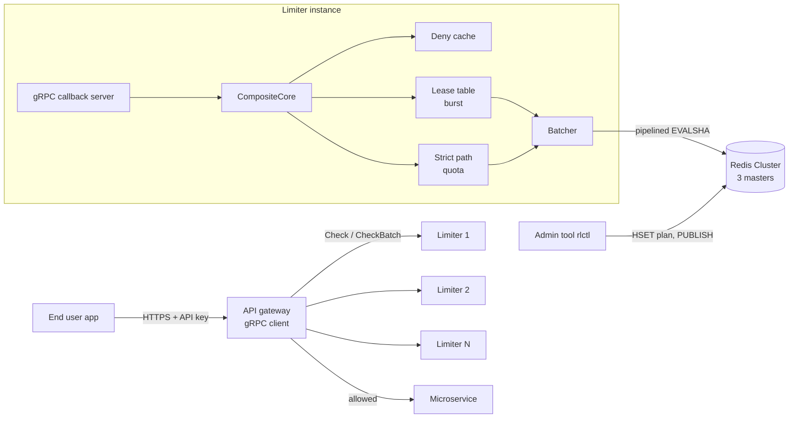

# Design

Status: skeleton with writing hints. Each section names the week it is written in. This file is the
engineering design (what and why, with numbers); the thesis Chapter 3 is written from it, so keep
the two consistent. Replace every `HINT` block with real content and delete the hint.

## 1. Problem and goals (Week 2)

The service answers one question for every API call a customer makes: may this call pass now?
The answer has two halves with opposite requirements.

**Per customer, a correctness problem.** A plan sells a daily quota (Free 200, Pay 2,000 calls per
UTC day). That number is what the customer pays for, so it must be enforced exactly:

| Goal | Measurable form | Checked by |
| --- | --- | --- |
| G1 No over-admission | concurrent calls from any number of limiter instances never admit more than the quota | `GrpcQuotaIT` (exactly 200 of 400 concurrent calls), evaluation test 1 |
| G2 Retries counted once | a call resent with the same `request_id` within 5 minutes is not counted again | Week 4 deduplication tests |
| G3 Plan changes apply on the next call | an upgrade raises the limit on the next request on every instance and keeps today's usage | `QuotaUpgradeMidDayKeepsUsageAndAppliesImmediately` (script); end to end with the plan cache (Week 4) |
| G4 One reset moment | every instance resets every customer at the same instant, 00:00 UTC by the Redis clock | `QuotaResetsOnNewUtcDay`, evaluation test 2 |

**Across the platform, a throughput problem.** Most traffic is burst-limited calls from customers
far below their quota, and the limiter is on the path of every one of them:

| Goal | Measurable form | Status |
| --- | --- | --- |
| G5 Throughput | about 1,000,000 checks/s across the cluster by adding instances and Redis masters | target; extrapolated from per-instance measurements (section 9), never reported as measured |
| G6 Latency | server-side p50 < 500 µs and p99 < 2 ms for a check | target; only the lease path can reach it (strict p99 is 10 ms at c=64 on the laptop) |
| G7 Bounded inaccuracy | burst over-admission at most N × C per refill interval (N instances, chunk C), measured | derived in section 6, measured in Week 6 |
| G8 Overload and floods | an over-quota client is refused locally (deny cache) and an overloaded instance answers `RESOURCE_EXHAUSTED` instead of queueing | Weeks 4 and 5 |
| G9 Documented failure behaviour | with Redis slow or down, each plan behaves as its failure policy says (paid fail open, free fail closed) | Week 5, evaluation test 9 |

The split between the two halves is the central design decision: the quota (G1 to G4) is checked
strictly in Redis on every call, while the burst limit (G5 to G7) is served from local leases and
may be wrong by a bounded, measured amount.

**Non-goals.** Billing, invoicing and payment (the limiter emits usage events; a billing system
would consume them); accounts, sign-up and API key issuance (simulated by `tools/seed_plans.sh` and
later `rlctl`); any user interface; multiple regions (one Redis Cluster, one region); per-customer
time zones for the reset (one UTC reset for everyone, a product decision in CUSTOMER_PLANS.md).

## 2. Architecture (Week 3, final in Week 5)

> HINT: One diagram and one paragraph per box. Reuse the sequence and decision-tree diagrams from
> the Quota Service Flow page (Mermaid renders on GitHub).

## 3. Redis client choice (Week 1)

**Decision:** the backend uses redis-plus-plus `AsyncRedisCluster`. Week 2 made the switch:
`RedisPPBackend` (`src/redis/redispp_backend.cc`) replaced the single-node `HiredisBackend`, which
measured the Week 1 numbers and remains in the git history.

**What was tested.** `src/redis/spike/spike_cluster_pipeline.cc` loads `token_bucket.lua` on every
master, then keeps up to 1,000 `EVALSHA` calls in flight per sending thread against the 3-master
dev cluster (`docker/docker-compose.dev.yml`), over 10,000 keys spread across all slots. Laptop,
one run per cell, raw output in `results/2026-10-17_redis_client_spike/`.

| Sending threads | pool 1 | pool 4 | pool 8 |
| --- | --- | --- | --- |
| 1 | 290,800 | 276,498 | 279,200 |
| 4 | 354,470 | 316,394 | 311,878 |
| 8 | 356,790 | 359,793 | 342,122 |

Calls per second, all three masters together.

**Reading.** Pipelining comes for free: issuing async calls without waiting already batches them on
each node's connection, so one thread on one connection per master reaches 290k calls/s. The pool
size does not matter, because every connection is driven by the client's single libuv event-loop
thread. At about 360k calls/s that thread uses 90% of a core and each master about 105%, so this is
the limit of the three masters on this laptop (about 120k script calls/s each), not of the client.
Week 3's batcher therefore only needs to add bounding and metrics (src/redis/README.md, last hint).

**When a master died** (`stop redis-2` mid-run, no replicas):

| Time after the stop | What the client saw |
| --- | --- |
| 0 to 5 s | Only keys on the dead master fail (`Connection reset by peer`, `Server closed the connection`); the other two keep serving |
| after `cluster-node-timeout` (5 s) | `cluster_state:fail`: every master answers `CLUSTERDOWN The cluster is down`, so healthy slots fail too |
| after restart | Node rejoins with its slots but empty (no persistence): its keys get `NOSCRIPT` until `EVAL` reloads the script, and their counters restart from zero |

That gives Week 5 its list: map connection errors and `CLUSTERDOWN` to `kUnavailable`; add replicas
so a replica is promoted before the node timeout matters; decide whether to set
`cluster-require-full-coverage no` so one lost master does not stop the other two; and keep the
`NOSCRIPT` to `EVAL` fallback, because a restarted or promoted node has no scripts. A related finding
from the Docker run: with the limiters' `redis` container stopped, each `HiredisBackend` reconnect
blocks its only thread on DNS lookup for about 3.6 s (the hiredis connect timeout does not cover
DNS), so fail-open checks answered `REASON_UNVERIFIED` 3.6 s late. Connects must not block the
thread that answers calls.

**Why not stay on hiredis.** The pipelining numbers would be similar; the difference is the
cluster. hiredis would need our own slot map (`CLUSTER SLOTS`, CRC16 of the hash tag), one
connection and event loop per master, `MOVED`/`ASK` handling and slot map refresh after a
failover: all logic redis-plus-plus already implements and tests. The cost is a dependency that
Ubuntu does not package, so `scripts/setup.sh` and the Docker image build it from source.

**What the implementation had to work around (Week 2).** The cluster client has callback versions
of ordinary commands (`HGETALL`, used for plans) but only future versions of `EVALSHA` and `EVAL`,
and waiting on a future would need a thread per call. Scripts therefore go through
`cluster.redis(key)`, a handle to the node that owns the key's slot, which does have callback
`EVALSHA`. Two consequences. First, the slot map loads in the background, so the backend makes one
routed call at startup and waits for it (at most 2 s) before serving. Second, a script sent to a
node that lost the slot gets `MOVED` as an error instead of a redirect; after a failover, scripts on
the moved slots fail (the rule's failure policy answers) until the client refreshes its slot map,
every 10 s or on the next routed command that sees `MOVED`. Week 5's failover tests decide whether
that window needs a retry through a routed command. The script SHA1 is computed locally (OpenSSL),
so no `SCRIPT LOAD` is needed: the first `EVALSHA` on a node without the script gets `NOSCRIPT`, and
the backend sends `EVAL` once, which runs the script and caches it there.

## 4. Data model (Week 1, extended Week 4)

| Key (example) | Type and fields | Written by | Expires |
| --- | --- | --- | --- |
| `{cust:42}:plan` | HASH plan, daily, burst, refill, overage, extra, failure | `tools/seed_plans.sh`, later `rlctl` | never |
| `{cust:42}:daily_quota:q` | HASH day, used (overage_used from Week 4) | `quota.lua` | end of the UTC day + 1 h |
| `{cust:42}:burst:tb` | HASH tokens (milli-tokens), last_refill_ms | `token_bucket.lua` | when the bucket would be full again, + 1 s |
| `{user:42}:demo_sliding_window:sw` | HASH current and previous window counts | `sliding_window.lua` | from the window length |
| `{user:42}:demo_fixed_window:fw` | counter of the current window | `fixed_window.lua` | end of the window |
| `{cust:42}:req:<id>` | STRING encoded result | `quota.lua` (Week 4) | 5 min |

Every key is built in `src/redis/keys.h` as `{<entity>}:<rule>:<algorithm>`, except the plan.

**The hash tag is the limited entity.** Redis Cluster places a key by the part in braces only, so
every key of one customer lives on one master, and a single script may touch several of them
atomically (Week 4's deduplication needs the quota and request keys together). Gateways send the
entity id, never a key (proto question 1), so the format exists in one place. The rule name lets
several rules of one algorithm coexist for a customer, and the algorithm suffix means a rule whose
algorithm changes starts fresh instead of misreading state of another shape.

**`used`, not `remaining`.** The quota hash stores what was consumed, and the limit arrives as an
argument on every call, read from the current plan. A plan change therefore rewrites nothing: an
upgrade from 200 to 2,000 turns `used` 200 into 1,800 remaining on the next request (step B5), and a
downgrade below today's usage denies with remaining 0, never a negative number (step B6).

**Milli-tokens.** The token bucket stores integers in thousandths of a token. A refill adds
elapsed milliseconds × rate milli-tokens, an exact integer, so millions of refills accumulate no
floating-point drift.

**Redis `TIME`, not the limiter's clock.** Each script reads the clock of the node that owns the
key, so every limiter instance agrees on "now" and on the UTC day, and a limiter with a skewed clock
cannot corrupt state. The cost, time from one node, is acceptable because each key lives on exactly
one node anyway. A failover to a replica whose clock is behind is handled by clamping elapsed time
at zero, so tokens never go negative.

**A TTL on every write.** Idle buckets and yesterday's quota expire on their own, so memory follows
the active customers, not every customer ever seen.

## 5. Quota and overage logic (Week 4)

> HINT: The three policies with one worked example each: request 2,001 for a `hard`, a `grace` and
> a `cap` customer. Include the decision order from `CompositeCore` (suspended, deny cache, burst,
> quota) and why burst goes first. Explain request ID deduplication and its limit (quota only).

## 6. Lease protocol and accuracy bound (Week 3, measured Week 6)

> HINT: How a lease works (atomic take, single-flight refill, low watermark, adaptive chunk with a
> cap). Then the derivation: with N instances and chunk C, at most N × C tokens are outside Redis,
> so admitted ≤ limit + N × C per refill interval. Then the measured result from the accuracy test
> and a plot of over-admission against chunk size. End with the tuning rule: choose the cap from
> the over-admission you can accept.

## 7. Strict versus leased (Week 3, numbers in Week 7)

| Mode | Redis calls per check | Throughput (1 instance) | p50 | p99 | Accuracy |
| --- | --- | --- | --- | --- | --- |
| Strict | 1 | HINT | HINT | HINT | exact |
| Leased | about 1 / chunk | HINT | HINT | HINT | within N × C |

> HINT: When to choose strict: when one chunk would be a large share of the limit (login attempts,
> Free daily quota) or when exactness is a product promise.

## 8. Failure modes (Week 5)

| Failure | Detection | Behaviour | Recovery |
| --- | --- | --- | --- |
| Redis master down | timeouts, breaker opens | leases serve; then fail open (paid) or closed (free) | replica promoted after node timeout; breaker probe closes |
| Redis slow (20 ms) | latency histogram | HINT | HINT |
| `NOSCRIPT` after failover | error reply | `EVAL` with source once, then `EVALSHA` | automatic |
| `MOVED` / `ASK` | redirect reply | client refreshes slot map and retries | automatic |
| Limiter overloaded | in-flight count | `RESOURCE_EXHAUSTED` | client backs off |
| Limiter crash with leased tokens | | tokens lost (stricter, never looser) | none needed |
| Missed plan-change message | | old plan until cache TTL | TTL expiry |

## 9. Capacity math for 1M checks/s (Week 2 estimate, Week 8 final)

Week 2 estimate. Every input is a laptop measurement with the load generator on the same machine;
the outputs are **estimates, not measurements**.

| Input | Value | Source |
| --- | --- | --- |
| Strict quota checks, 1 instance, where the curve flattens | 25,301 checks/s at p99 84.8 ms (c = 1,024; range 21,616 to 27,840) | Week 2 baseline, median of 5 |
| Strict quota checks at a usable latency | 10,024 checks/s at p99 10.5 ms (c = 64) | Week 2 ramp, 1 run |
| gRPC alone (`allow_all`), same load | 34,362 checks/s (load-generator bound) | Week 2 baseline, median of 5 |
| Leased burst checks, 1 instance | at least 31,461 checks/s (load-generator bound, within 3% of `allow_all`) | 2026-10-12, 1 run |
| Script calls one Redis master absorbs | about 120,000/s | Week 1 spike |
| Redis calls per strict check | 2 today (plan read, quota script); 1 with the Week 4 plan cache | design |
| Redis calls per leased check | 1 per refill; a refill carries a chunk of 10% of the limit | design |

Estimate for 1,000,000 checks/s:

- **All checks strict (daily quota):** 2,000,000 Redis calls/s today, so about 17 masters at 120k
  each; about 9 once the plan cache removes the plan read. Instances: 1,000,000 / 25,301 ≈
  40 at the flattening point (p99 around 85 ms), or about 100 at p99 10 ms. The
  instance count, not Redis, is the cost of strict mode.
- **All checks leased (burst):** Redis sees refills only. With `api_default` (limit 1,000, chunk
  100) a refill serves up to 100 checks, so about 10,000 refills/s: a fraction of one master.
  Instances: 1,000,000 / 31,461 ≈ 32, an upper bound on the count because 31,461 is a lower bound on
  what one instance does (ghz, not the limiter, was the limit).
- **One API call = burst (leased) + quota (strict), as CompositeCore will do:** the quota half
  dominates. Redis needs about 9 masters (with the plan cache); the instance count follows the
  strict path until Week 3 and 4 measure the composite.

Assumptions, each to be checked: per-instance throughput on server hardware equals the laptop's;
throughput scales linearly with instances (measured from 1 to 4 instances in Week 7); keys spread
evenly over slots (a single hot customer stays on one master: the lease protects it); the Docker
network's sub-millisecond RTT. A real network adds latency, which leases hide and strict checks do
not.

## 10. Tuning guide (Week 7)

| Knob | Default | Raise it when | Lower it when |
| --- | --- | --- | --- |
| Chunk cap (fraction of limit) | 10% | Redis is the bottleneck | over-admission is too high |
| Batcher `max_delay` | 200 µs | batches are small and Redis is busy | p99 is too high |
| Batcher `max_batch` | 128 | flushes are mostly by size | |
| Plan cache TTL | 5 s | plan reads show in the profile | upgrades must apply faster without Pub/Sub |
| Instances | | CPU of instances is saturated | |
| Redis masters | 3 | a master's CPU is saturated | |

## 11. Limitations and future work (Week 8)

> HINT: Write each limitation the day you meet it. Expected ones: laptop-only measurement, Docker
> network latency far below real networks, burst checks not deduplicated, counters can be lost on a
> failover before replication (usage events are the durable record), single region only.
