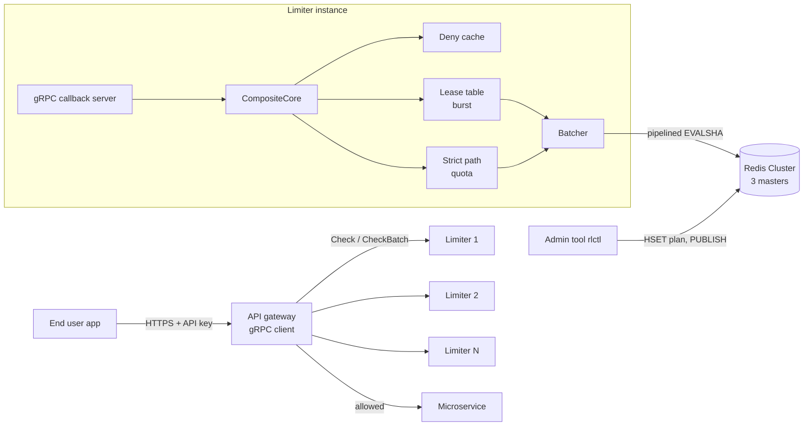

# Design

Status: skeleton with writing hints. Each section names the week it is written in. This file is the
engineering design (what and why, with numbers); the thesis Chapter 3 is written from it, so keep
the two consistent. Replace every `HINT` block with real content and delete the hint.

## 1. Problem and goals (Week 2)

> HINT: Two halves, from the plan. Per customer, a correctness problem: exact daily quotas
> (Free 200, Pay 2,000), retries never double counted, upgrades applied on the next request, one
> reset moment for every instance. Across the platform, a throughput problem: about 1M checks/s,
> p50 < 500 µs and p99 < 2 ms server-side, floods from over-quota clients, hot enterprise keys.
> State the non-goals: billing, accounts, UI, multi-region.

## 2. Architecture (Week 3, final in Week 5)

> HINT: One diagram and one paragraph per box. Reuse the sequence and decision-tree diagrams from
> the Quota Service Flow page (Mermaid renders on GitHub).

## 3. Redis client choice (Week 1)

**Decision:** the cluster backend (Week 2) uses redis-plus-plus `AsyncRedisCluster`. The existing
`HiredisBackend` stays for single-node runs and as the measured baseline until the switch.

**What was tested.** `src/redis/spike/spike_cluster_pipeline.cc` loads `token_bucket.lua` on every
master, then keeps up to 1,000 `EVALSHA` calls in flight per sending thread against the 3-master
dev cluster (`docker/docker-compose.dev.yml`), over 10,000 keys spread across all slots. Laptop,
one run per cell, raw output in `results/2026-10-17_redis_client_spike/`.

| Sending threads | pool 1 | pool 4 | pool 8 |
| --- | --- | --- | --- |
| 1 | 290,800 | 276,498 | 279,200 |
| 4 | 354,470 | 316,394 | 311,878 |
| 8 | 356,790 | 359,793 | 342,122 |

Calls per second, all three masters together.

**Reading.** Pipelining comes for free: issuing async calls without waiting already batches them on
each node's connection, so one thread on one connection per master reaches 290k calls/s. The pool
size does not matter, because every connection is driven by the client's single libuv event-loop
thread. At about 360k calls/s that thread uses 90% of a core and each master about 105%, so this is
the limit of the three masters on this laptop (about 120k script calls/s each), not of the client.
Week 3's batcher therefore only needs to add bounding and metrics (src/redis/README.md, last hint).

**When a master died** (`stop redis-2` mid-run, no replicas):

| Time after the stop | What the client saw |
| --- | --- |
| 0 to 5 s | Only keys on the dead master fail (`Connection reset by peer`, `Server closed the connection`); the other two keep serving |
| after `cluster-node-timeout` (5 s) | `cluster_state:fail`: every master answers `CLUSTERDOWN The cluster is down`, so healthy slots fail too |
| after restart | Node rejoins with its slots but empty (no persistence): its keys get `NOSCRIPT` until `EVAL` reloads the script, and their counters restart from zero |

That gives Week 5 its list: map connection errors and `CLUSTERDOWN` to `kUnavailable`; add replicas
so a replica is promoted before the node timeout matters; decide whether to set
`cluster-require-full-coverage no` so one lost master does not stop the other two; and keep the
`NOSCRIPT` to `EVAL` fallback, because a restarted or promoted node has no scripts. A related finding
from the Docker run: with the limiters' `redis` container stopped, each `HiredisBackend` reconnect
blocks its only thread on DNS lookup for about 3.6 s (the hiredis connect timeout does not cover
DNS), so fail-open checks answered `REASON_UNVERIFIED` 3.6 s late. Connects must not block the
thread that answers calls.

**Why not stay on hiredis.** The pipelining numbers would be similar; the difference is the
cluster. hiredis would need our own slot map (`CLUSTER SLOTS`, CRC16 of the hash tag), one
connection and event loop per master, `MOVED`/`ASK` handling and slot map refresh after a
failover: all logic redis-plus-plus already implements and tests. The cost is a dependency that
Ubuntu does not package, so `scripts/setup.sh` builds it from source (the Docker image will too,
once the server links it).

## 4. Data model (Week 1, extended Week 4)

| Key | Type and fields | Written by | Expires |
| --- | --- | --- | --- |
| `{cust:N}:plan` | HASH plan, daily, burst, refill, overage, extra, failure | `rlctl` | never |
| `{cust:N}:quota` | HASH day, used, overage_used | `quota.lua` | end of day + 1 h |
| `{cust:N}:tb` | HASH tokens (milli), last_refill_ms | `token_bucket.lua` | TTL after last use |
| `{cust:N}:req:<id>` | STRING encoded result | `quota.lua` | 5 min |

> HINT: Explain the hash tag (all keys of a customer in one slot, so one script can use several of
> them), why `used` instead of `remaining` (plan changes never rewrite history), why milli-tokens
> (no float drift), and why Redis `TIME` instead of the caller's clock (one clock for all
> instances; clock skew cannot corrupt state; the cost is that time comes from one node, which is
> acceptable because each key lives on one node anyway).

## 5. Quota and overage logic (Week 4)

> HINT: The three policies with one worked example each: request 2,001 for a `hard`, a `grace` and
> a `cap` customer. Include the decision order from `CompositeCore` (suspended, deny cache, burst,
> quota) and why burst goes first. Explain request ID deduplication and its limit (quota only).

## 6. Lease protocol and accuracy bound (Week 3, measured Week 6)

> HINT: How a lease works (atomic take, single-flight refill, low watermark, adaptive chunk with a
> cap). Then the derivation: with N instances and chunk C, at most N × C tokens are outside Redis,
> so admitted ≤ limit + N × C per refill interval. Then the measured result from the accuracy test
> and a plot of over-admission against chunk size. End with the tuning rule: choose the cap from
> the over-admission you can accept.

## 7. Strict versus leased (Week 3, numbers in Week 7)

| Mode | Redis calls per check | Throughput (1 instance) | p50 | p99 | Accuracy |
| --- | --- | --- | --- | --- | --- |
| Strict | 1 | HINT | HINT | HINT | exact |
| Leased | about 1 / chunk | HINT | HINT | HINT | within N × C |

> HINT: When to choose strict: when one chunk would be a large share of the limit (login attempts,
> Free daily quota) or when exactness is a product promise.

## 8. Failure modes (Week 5)

| Failure | Detection | Behaviour | Recovery |
| --- | --- | --- | --- |
| Redis master down | timeouts, breaker opens | leases serve; then fail open (paid) or closed (free) | replica promoted after node timeout; breaker probe closes |
| Redis slow (20 ms) | latency histogram | HINT | HINT |
| `NOSCRIPT` after failover | error reply | `EVAL` with source once, then `EVALSHA` | automatic |
| `MOVED` / `ASK` | redirect reply | client refreshes slot map and retries | automatic |
| Limiter overloaded | in-flight count | `RESOURCE_EXHAUSTED` | client backs off |
| Limiter crash with leased tokens | | tokens lost (stricter, never looser) | none needed |
| Missed plan-change message | | old plan until cache TTL | TTL expiry |

## 9. Capacity math for 1M checks/s (Week 2 estimate, Week 8 final)

> HINT: Per-instance throughput T (measured), lease hit ratio h (measured), checks per refill c.
> Instances = 1,000,000 / T. Redis calls/s = 1,000,000 × (strict share + (1 − h) for leased
> traffic) / batch factor. Masters needed = Redis calls/s ÷ measured calls/s per master. Write every
> assumption: same per-instance number on server hardware, network RTT, linear scaling as measured
> from 1 to 4 instances.

## 10. Tuning guide (Week 7)

| Knob | Default | Raise it when | Lower it when |
| --- | --- | --- | --- |
| Chunk cap (fraction of limit) | 10% | Redis is the bottleneck | over-admission is too high |
| Batcher `max_delay` | 200 µs | batches are small and Redis is busy | p99 is too high |
| Batcher `max_batch` | 128 | flushes are mostly by size | |
| Plan cache TTL | 5 s | plan reads show in the profile | upgrades must apply faster without Pub/Sub |
| Instances | | CPU of instances is saturated | |
| Redis masters | 3 | a master's CPU is saturated | |

## 11. Limitations and future work (Week 8)

> HINT: Write each limitation the day you meet it. Expected ones: laptop-only measurement, Docker
> network latency far below real networks, burst checks not deduplicated, counters can be lost on a
> failover before replication (usage events are the durable record), single region only.
