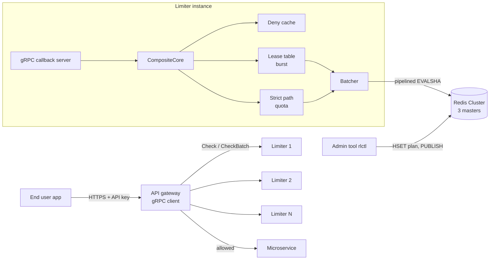

# Design

Status: skeleton with writing hints. Each section names the week it is written in. This file is the
engineering design (what and why, with numbers); the thesis Chapter 3 is written from it, so keep
the two consistent. Replace every `HINT` block with real content and delete the hint.

## 1. Problem and goals (Week 2)

The service answers one question for every API call a customer makes: may this call pass now?
The answer has two halves with opposite requirements.

**Per customer, a correctness problem.** A plan sells a daily quota (Free 200, Pay 2,000 calls per
UTC day). That number is what the customer pays for, so it must be enforced exactly:

| Goal | Measurable form | Checked by |
| --- | --- | --- |
| G1 No over-admission | concurrent calls from any number of limiter instances never admit more than the quota | `GrpcQuotaIT` (exactly 200 of 400 concurrent calls), evaluation test 1 |
| G2 Retries counted once | a call resent with the same `request_id` within 5 minutes is not counted again | Week 4 deduplication tests |
| G3 Plan changes apply on the next call | an upgrade raises the limit on the next request on every instance and keeps today's usage | `QuotaUpgradeMidDayKeepsUsageAndAppliesImmediately` (script); end to end with the plan cache (Week 4) |
| G4 One reset moment | every instance resets every customer at the same instant, 00:00 UTC by the Redis clock | `QuotaResetsOnNewUtcDay`, evaluation test 2 |

**Across the platform, a throughput problem.** Most traffic is burst-limited calls from customers
far below their quota, and the limiter is on the path of every one of them:

| Goal | Measurable form | Status |
| --- | --- | --- |
| G5 Throughput | about 1,000,000 checks/s across the cluster by adding instances and Redis masters | target; extrapolated from per-instance measurements (section 9), never reported as measured |
| G6 Latency | server-side p50 < 500 µs and p99 < 2 ms for a check | target; only the lease path can reach it (strict p99 is 10 ms at c=64 on the laptop) |
| G7 Bounded inaccuracy | burst over-admission at most N × C per refill interval (N instances, chunk C), measured | derived in section 6, measured in Week 6 |
| G8 Overload and floods | an over-quota client is refused locally (deny cache) and an overloaded instance answers `RESOURCE_EXHAUSTED` instead of queueing | Weeks 4 and 5 |
| G9 Documented failure behaviour | with Redis slow or down, each plan behaves as its failure policy says (paid fail open, free fail closed) | Week 5, evaluation test 9 |

The split between the two halves is the central design decision: the quota (G1 to G4) is checked
strictly in Redis on every call, while the burst limit (G5 to G7) is served from local leases and
may be wrong by a bounded, measured amount.

**Non-goals.** Billing, invoicing and payment (the limiter emits usage events; a billing system
would consume them); accounts, sign-up and API key issuance (simulated by `tools/seed_plans.sh` and
later `rlctl`); any user interface; multiple regions (one Redis Cluster, one region); per-customer
time zones for the reset (one UTC reset for everyone, a product decision in CUSTOMER_PLANS.md).

## 2. Architecture (Week 3, final in Week 5)

> HINT: One diagram and one paragraph per box. Reuse the sequence and decision-tree diagrams from
> the Quota Service Flow page (Mermaid renders on GitHub).

## 3. Redis client choice (Week 1)

**Decision:** the backend uses redis-plus-plus `AsyncRedisCluster`. Week 2 made the switch:
`RedisPPBackend` (`src/redis/redispp_backend.cc`) replaced the single-node `HiredisBackend`, which
measured the Week 1 numbers and remains in the git history.

**What was tested.** `src/redis/spike/spike_cluster_pipeline.cc` loads `token_bucket.lua` on every
master, then keeps up to 1,000 `EVALSHA` calls in flight per sending thread against the 3-master
dev cluster (`docker/docker-compose.dev.yml`), over 10,000 keys spread across all slots. Laptop,
one run per cell, raw output in `results/2026-10-17_redis_client_spike/`.

| Sending threads | pool 1 | pool 4 | pool 8 |
| --- | --- | --- | --- |
| 1 | 290,800 | 276,498 | 279,200 |
| 4 | 354,470 | 316,394 | 311,878 |
| 8 | 356,790 | 359,793 | 342,122 |

Calls per second, all three masters together.

**Reading.** Pipelining comes for free: issuing async calls without waiting already batches them on
each node's connection, so one thread on one connection per master reaches 290k calls/s. The pool
size does not matter, because every connection is driven by the client's single libuv event-loop
thread. At about 360k calls/s that thread uses 90% of a core and each master about 105%, so this is
the limit of the three masters on this laptop (about 120k script calls/s each), not of the client.
Week 3's batcher therefore only needs to add bounding and metrics (src/redis/README.md, last hint).

**When a master died** (`stop redis-2` mid-run, no replicas):

| Time after the stop | What the client saw |
| --- | --- |
| 0 to 5 s | Only keys on the dead master fail (`Connection reset by peer`, `Server closed the connection`); the other two keep serving |
| after `cluster-node-timeout` (5 s) | `cluster_state:fail`: every master answers `CLUSTERDOWN The cluster is down`, so healthy slots fail too |
| after restart | Node rejoins with its slots but empty (no persistence): its keys get `NOSCRIPT` until `EVAL` reloads the script, and their counters restart from zero |

That gives Week 5 its list: map connection errors and `CLUSTERDOWN` to `kUnavailable`; add replicas
so a replica is promoted before the node timeout matters; decide whether to set
`cluster-require-full-coverage no` so one lost master does not stop the other two; and keep the
`NOSCRIPT` to `EVAL` fallback, because a restarted or promoted node has no scripts. A related finding
from the Docker run: with the limiters' `redis` container stopped, each `HiredisBackend` reconnect
blocks its only thread on DNS lookup for about 3.6 s (the hiredis connect timeout does not cover
DNS), so fail-open checks answered `REASON_UNVERIFIED` 3.6 s late. Connects must not block the
thread that answers calls.

**Why not stay on hiredis.** The pipelining numbers would be similar; the difference is the
cluster. hiredis would need our own slot map (`CLUSTER SLOTS`, CRC16 of the hash tag), one
connection and event loop per master, `MOVED`/`ASK` handling and slot map refresh after a
failover: all logic redis-plus-plus already implements and tests. The cost is a dependency that
Ubuntu does not package, so `scripts/setup.sh` and the Docker image build it from source.

**What the implementation had to work around (Week 2).** The cluster client has callback versions
of ordinary commands (`HGETALL`, used for plans) but only future versions of `EVALSHA` and `EVAL`,
and waiting on a future would need a thread per call. Scripts therefore go through
`cluster.redis(key)`, a handle to the node that owns the key's slot, which does have callback
`EVALSHA`. Two consequences. First, the slot map loads in the background, so the backend makes one
routed call at startup and waits for it (at most 2 s) before serving. Second, a script sent to a
node that lost the slot gets `MOVED` as an error instead of a redirect; after a failover, scripts on
the moved slots fail (the rule's failure policy answers) until the client refreshes its slot map,
every 10 s or on the next routed command that sees `MOVED`. Week 5's failover tests decide whether
that window needs a retry through a routed command. The script SHA1 is computed locally (OpenSSL),
so no `SCRIPT LOAD` is needed: the first `EVALSHA` on a node without the script gets `NOSCRIPT`, and
the backend sends `EVAL` once, which runs the script and caches it there.

## 4. Data model (Week 1, extended Week 4)

| Key (example) | Type and fields | Written by | Expires |
| --- | --- | --- | --- |
| `{cust:42}:plan` | HASH plan, daily, burst, refill, overage, extra, failure | `tools/seed_plans.sh`, `tools/rlctl` (then `PUBLISH plan-changes cust:42`) | never |
| `{cust:42}:daily_quota:q` | HASH day, used, overage_used | `quota.lua` | end of the UTC day + 1 h |
| `{cust:42}:burst:tb` | HASH tokens (milli-tokens), last_refill_ms | `token_bucket.lua` | when the bucket would be full again, + 1 s |
| `{user:42}:demo_sliding_window:sw` | HASH current and previous window counts | `sliding_window.lua` | from the window length |
| `{user:42}:demo_fixed_window:fw` | counter of the current window | `fixed_window.lua` | end of the window |
| `{cust:42}:daily_quota:req:<id>` | STRING `allowed,used,remaining,overage` | `quota.lua` | 5 min |

Every key is built in `src/redis/keys.h` as `{<entity>}:<rule>:<algorithm>`, except the plan.

**The hash tag is the limited entity.** Redis Cluster places a key by the part in braces only, so
every key of one customer lives on one master, and a single script may touch several of them
atomically (Week 4's deduplication needs the quota and request keys together). Gateways send the
entity id, never a key (proto question 1), so the format exists in one place. The rule name lets
several rules of one algorithm coexist for a customer, and the algorithm suffix means a rule whose
algorithm changes starts fresh instead of misreading state of another shape.

**`used`, not `remaining`.** The quota hash stores what was consumed, and the limit arrives as an
argument on every call, read from the current plan. A plan change therefore rewrites nothing: an
upgrade from 200 to 2,000 turns `used` 200 into 1,800 remaining on the next request (step B5), and a
downgrade below today's usage denies with remaining 0, never a negative number (step B6).

**Milli-tokens.** The token bucket stores integers in thousandths of a token. A refill adds
elapsed milliseconds × rate milli-tokens, an exact integer, so millions of refills accumulate no
floating-point drift.

**Redis `TIME`, not the limiter's clock.** Each script reads the clock of the node that owns the
key, so every limiter instance agrees on "now" and on the UTC day, and a limiter with a skewed clock
cannot corrupt state. The cost, time from one node, is acceptable because each key lives on exactly
one node anyway. A failover to a replica whose clock is behind is handled by clamping elapsed time
at zero, so tokens never go negative.

**A TTL on every write.** Idle buckets and yesterday's quota expire on their own, so memory follows
the active customers, not every customer ever seen.

## 5. Quota and overage logic (Week 4)

**One rule per API call.** A gateway sends `Check{key: "cust:42", rule: "customer"}`. The
`customer` rule (`config/rules.yaml`) names a token-bucket rule (`burst`) and a quota rule
(`daily_quota`), and `CompositeCore` (`src/core/composite_core.cc`) reads the plan once and decides
in this order:

1. **Suspended plan:** `SUSPENDED` (HTTP 403), no script call.
2. **Deny cache hit:** `QUOTA_EXHAUSTED` with the cached reset, no script call.
3. **Burst:** a denial answers `RATE_LIMITED` at once and uses no quota.
4. **Daily quota** under the plan's overage policy. On a denial the burst token goes back
   (`lua/return_lease.lua`) and the denial is cached.

Burst goes first because a request refused for burst must not consume daily quota, and because it
becomes a local check once burst is leased per customer (with the plan cache). The give-back matters:
without it an over-quota customer drains their own burst bucket and later sees `RATE_LIMITED`
instead of the true reason.

**Request 2,001 on three policies** (a plan of 2,000 a day, 2,000 used):

| Policy | Plan | Request 2,001 | After it |
| --- | --- | --- | --- |
| `hard` | free | denied, `QUOTA_EXHAUSTED`, retry at 00:00 UTC | used 2,000 |
| `grace`, extra 200 | pay | allowed, `OK`, remaining 0 | used 2,001; denied after 2,200 |
| `cap`, extra 1,000 | pay_cap | allowed, `OVERAGE` | used 2,000, overage_used 1; denied after 1,000 more |

Grace is free, so it answers `OK`; cap is billed, so it answers `OVERAGE` and counts the overage
apart from the plan, for billing. A cap request that straddles the limit bills only the part beyond
it. Both counters reset with the UTC day. Tested in `tests/lua_scripts_test.cc` and through gRPC in
`tests/grpc_quota_it.cc` (the Week 4 gate).

**Deny cache** (`src/lease/deny_cache.h`). After a `QUOTA_EXHAUSTED` answer the instance remembers
the customer until now + `reset_after_ms`, the reset Redis returned, so the entry ends when the
Redis counter does. Each entry also keeps a stamp of the plan's quota terms (daily, policy, extra).
A check under a different plan ignores and drops the entry, so an upgrade lifts the denial on the
very next request, without trusting plan-change messages to arrive. With the plan cache, a denied
customer costs no Redis call at all until the reset or a plan change.

**Request ID deduplication.** A non-empty `request_id` makes `quota.lua` store its answer under
`{cust:42}:daily_quota:req:<id>` for 5 minutes, with the same hash tag as the counter, so one atomic
script reads and writes both. A retry gets the stored answer, denials included, and is not counted
again. The rule name is part of the key so two quota rules never share an answer. Limits:

- Quota only. Burst is not deduplicated: a retry is still traffic.
- The deny cache answers before Redis. A retry of a request that was allowed, arriving after the
  quota ran out on this instance, is denied locally. It is not counted twice, but its answer differs
  from the original.
- Closed: a retried denial replayed after an upgrade used to put the customer back in the deny
  cache under the new plan. `quota.lua` now marks replayed answers, and `CompositeCore` neither
  caches nor records them.

**Plan cache and plan changes** (`src/plan/plan_store.cc`, `src/redis/plan_listener.cc`). Each
instance keeps a customer's plan for 5 s (`RL_PLAN_TTL_MS`), so a check costs one script call
instead of a plan read and a script call. A miss sends one `HGETALL` however many checks wait for
it. `rlctl` writes the plan hash first, then publishes the customer ID on `plan-changes`; every
instance drops its cached plan and deny-cache entry. A read in flight when the message arrives is
thrown away and sent again, because it may have read the old hash. A subscriber that reconnects
drops every cached plan, since Pub/Sub keeps no messages for an absent subscriber. The bound: a plan
change applies within the message delay normally (22 ms measured from starting `rlctl` to both of
two instances, `tests/plan_change_it.cc`), and within the 5 s TTL if a message is lost while the
connection looks healthy.

**Usage events** (`src/usage/usage_log.cc`, steps A13 and B8). With `RL_USAGE_FILE` set, every customer
decision is recorded once, with its reason and cost, into a bounded buffer that a background
thread sums per customer and minute and appends to a JSON-lines file every second. A full buffer
drops and counts; it never delays the answer. A retried request ID's stored answer is not recorded,
so the file counts each request once: in a smoke run its `allowed` total equalled Redis `used`
exactly (5,049), with 1,757 retries in the traffic. `tools/usage_report.py` sums files across
instances. Billing reads `allowed + overage`; `unverified` admissions are listed but not billed.

**Leased quota for large plans** (`quota_mode: auto`, `src/core/composite_core.cc`). A plan of
100,000 a day or more (`kLeasedQuotaFrom`) takes step 4 from a lease of its daily counter, through
the lease engine of section 6: chunks of at most 0.1% of the limit (C = 1,000 for the enterprise
plan of 1,000,000), refilled by `quota.lua` itself with the chunk as the cost and the hard policy.
A lease therefore takes only units inside the plan. When the counter has less than a chunk left, the
lease takes what is left, then denies locally until the reset, and a check it denies goes the exact
path, which applies the plan's overage policy and request ID. Overage, which is billed, is always
counted exactly. The lease refills with a rule that holds the plan's limit; there is one such rule
per distinct daily limit, made on first use in a lock-free table, so an upgrade gets a new lease
under the new limit at once.

- **Bound.** Redis grants at most `limit` units a day. Units leased before 00:00 UTC and used after
  it were counted for the old day, so in one day N instances admit at most limit + N × C: 0.4% of
  the day for four instances. Units leased and not used are at most N × C under-admission.
- **Measured** (`tests/leased_quota_it.cc`, the Week 4 gate): four instances, a plan of 100,000 a
  day (C = 100), checks of cost 10, 20% more demand than the bound: exactly 100,000 units admitted,
  with 1,253 quota calls for 12,048 checks (the exact path makes one per check).
- **Limits.** A leased check does not deduplicate request IDs: a retry inside the plan counts
  again, while a retry of an overage request does not, because overage takes the exact path. A
  leased answer's `remaining` is this instance's lease (a lower bound of the customer's remaining),
  and its reset time comes from the instance's UTC clock, not Redis `TIME`. Burst is still one Redis
  call per check (the `CompositeCore` shortcut), so a leased check costs one Redis call, not two.

**What a customer check shares with other threads.** With the quota leased, a hot customer's checks
meet on the shared structures, so those are lock-free on the common path: lease hits (one CAS, since
Week 3), plan cache hits (a per-thread copy checked against the store's generation counter), deny
lookups in a shard with no denial (one atomic load), usage events (16 lock-free rings) and the
leased-quota rules (an insert-only table). Locks remain on slow paths only: a plan miss or a thread's
first read of a plan, a deny shard that holds a denial, a lease refill, the optional batcher. One
customer on 16 threads, before and after: plan hits 4.1 to 263.8 M/s, deny lookups 12.2 to 2,090 M/s,
usage events 5.3 to 55.4 M/s (`results/2026-10-18_customer_microbench/NOTES.md`).

## 6. Lease protocol and accuracy bound (Week 3, measured Week 6)

**The protocol as built** (`src/core/leased_core.cc`, `src/lease/`). A lease holds tokens that one
instance has already taken from the shared Redis bucket of a (rule, key).

- **Hit:** one compare-and-swap (`TryTake`) that never takes the lease below zero. No lock, no
  allocation, no Redis.
- **Single flight:** at most one refill per lease is in flight. A check that finds the lease empty
  parks, and every parked check is answered when that refill lands (500 concurrent misses cause one
  refill: `ConcurrentMissesShareOneRefillAndAllGetItsAnswer`).
- **Early refill:** a hit that leaves less than 30% of the current chunk starts a refill, so steady
  traffic never waits for Redis.
- **Top-up:** a refill asks Redis for `target − tokens held`, not `target`. The target is the chunk,
  or the cost of the parked check if that is larger. After a refill lands, the lease holds at most
  one chunk.
- **Big checks:** a check whose cost exceeds the chunk cap C skips the lease and asks Redis
  directly, on the same bucket.
- **Adaptive chunk:** each lease starts at the cap and changes once per full refill. It doubles when
  checks found the lease dry while the refill was out (demand outran the chunk within one round
  trip) and halves when the previous chunk lasted more than 10 s (its tokens sat unused, invisible
  to other instances). It always stays within [min(8, C), C], with C = max(1, ⌊limit / 10⌋). Every
  change can be logged (`RL_CHUNK_LOG=<file>`) for the chunk-versus-demand plot.
- **Redis says no:** the lease denies locally until the retry time Redis returned.

**Invariant.** An instance never holds more than C tokens of one bucket, except for the instant
between a refill landing and the parked check that asked for those tokens taking them.

**Bound.** Take any interval [a, b]. Every token admitted in it was either held by some instance at
a or granted by Redis during [a, b]. The bucket holds at most `limit` tokens at a and refills at rate
r, so Redis grants at most limit + r·(b − a) during the interval; N instances hold at most N·C at a.
Hence

    admitted(a, b) ≤ limit + r·(b − a) + N·C

An exact bucket admits at most limit + r·(b − a) in the same interval, so the over-admission in any
window is at most **N × C**. A leased daily quota (section 5) is the same protocol with r = 0 within
a day and C = max(1, ⌊limit / 1000⌋). It is temporal: tokens taken from Redis earlier are spent later. Leases
never create tokens, so over a whole day they admit no more than Redis granted.

**Evidence so far (Week 3).** `tests/lease_harness_test.cc` runs N = 1 to 4 `LeasedCore` instances
against a fake Redis that executes `token_bucket.lua`'s arithmetic. The fake answers in a seeded
random order, fails 2% of calls, and runs under a fake clock with jumps of up to 3 s. Seeds draw
limits of 10 to 2,000 and costs of 1 to 5. Every seed checks the bound over every window of
admissions, in one pass. Over 100,000 seeds (165 million checks) no window exceeded N × C, and the
worst reached it exactly, so the bound is tight, not loose. Before two fixes it was broken, and
the harness found both:

1. Adding a full chunk at the 30% watermark let an instance hold up to 1.3 × C. Seed 1177 (N = 2,
   C = 9) admitted 18.79 over the exact bucket against a bound of 18. Fixed by the top-up.
2. A check costing more than C made a lease hold more than C. Seed 4388 (N = 2, C = 1, costs up to
   5) admitted 2.7 against a bound of 2. Fixed by sending such checks to Redis.

The price of the top-up is refills of 0.7 to 1.0 × C instead of exactly C, so somewhat more of
them; Week 7 measures it. The measured over-admission across instances against chunk size, on the
real cluster, is the Week 6 accuracy test.

**Tuning rule.** Over-admission per window is at most N × C, so choose the cap from the
over-admission you can accept: with 4 instances and a 10% cap, a burst limit of 1,000 may admit up
to 400 extra in a window.

## 7. Strict versus leased (Week 3, numbers in Week 7)

Week 3 numbers, one instance on the laptop, C++ load generator at 192 calls in flight (medians of
5, `results/2026-10-18_week3_gate/NOTES.md`); Week 7 repeats this as a full matrix.

| Mode | Redis calls per check | Throughput (1 instance) | p50 | p99 | Accuracy |
| --- | --- | --- | --- | --- | --- |
| gRPC alone (`allow_all`) | 0 | 71,364/s | 2.54 ms | 7.85 ms | none |
| Strict, token bucket | 1 | 11,259/s | 17.1 ms | 27.6 ms | exact |
| Strict, daily quota | 2 (plan read + script) | 10,534/s | 18.7 ms | 26.4 ms | exact |
| Leased, token bucket | 0.9% of checks waited for a refill | 70,694/s | 2.66 ms | 7.19 ms | within N × C |

At equal load the lease is 6.3 times the strict throughput and costs under 1% over gRPC alone; the
laptop's gRPC ceiling, not the lease, sets the leased number. At 10,000 checks/s offered (ghz) the
leased p50 is 0.40 ms and p99 2.20 ms, against 1.89 ms for gRPC alone.

When to choose strict: when one chunk would be a large share of the limit (login attempts, a Free
daily quota of 200, where C would be 20), or when exactness is a product promise.

## 8. Failure modes (Week 5)

| Failure | Detection | Behaviour | Recovery |
| --- | --- | --- | --- |
| Redis master down | timeouts, breaker opens | leases serve; then fail open (paid) or closed (free) | replica promoted after node timeout; breaker probe closes |
| Redis slow (20 ms) | latency histogram | HINT | HINT |
| `NOSCRIPT` after failover | error reply | `EVAL` with source once, then `EVALSHA` | automatic |
| `MOVED` / `ASK` | redirect reply | client refreshes slot map and retries | automatic |
| Limiter overloaded | in-flight count | `RESOURCE_EXHAUSTED` | client backs off |
| Limiter crash with leased tokens | | tokens lost (stricter, never looser) | none needed |
| Missed plan-change message | | old plan until cache TTL | TTL expiry |

## 9. Capacity math for 1M checks/s (Week 2 estimate, Week 8 final)

Week 2 estimate. Every input is a laptop measurement with the load generator on the same machine;
the outputs are **estimates, not measurements**.

| Input | Value | Source |
| --- | --- | --- |
| Strict quota checks, 1 instance, where the curve flattens | 25,301 checks/s at p99 84.8 ms (c = 1,024; range 21,616 to 27,840) | Week 2 baseline, median of 5 |
| Strict quota checks at a usable latency | 10,024 checks/s at p99 10.5 ms (c = 64) | Week 2 ramp, 1 run |
| gRPC alone (`allow_all`), same load | 34,362 checks/s (load-generator bound) | Week 2 baseline, median of 5 |
| Leased burst checks, 1 instance | at least 31,461 checks/s (load-generator bound, within 3% of `allow_all`) | 2026-10-12, 1 run |
| Script calls one Redis master absorbs | about 120,000/s | Week 1 spike |
| Redis calls per strict check | 2 today (plan read, quota script); 1 with the Week 4 plan cache | design |
| Redis calls per leased check | 1 per refill; a refill carries a chunk of 10% of the limit | design |

Estimate for 1,000,000 checks/s:

- **All checks strict (daily quota):** 2,000,000 Redis calls/s today, so about 17 masters at 120k
  each; about 9 once the plan cache removes the plan read. Instances: 1,000,000 / 25,301 ≈
  40 at the flattening point (p99 around 85 ms), or about 100 at p99 10 ms. The
  instance count, not Redis, is the cost of strict mode.
- **All checks leased (burst):** Redis sees refills only. With `api_default` (limit 1,000, chunk
  100) a refill serves up to 100 checks, so about 10,000 refills/s: a fraction of one master.
  Instances: 1,000,000 / 31,461 ≈ 32, an upper bound on the count because 31,461 is a lower bound on
  what one instance does (ghz, not the limiter, was the limit).
- **One API call = burst (leased) + quota (strict), as CompositeCore will do:** the quota half
  dominates. Redis needs about 9 masters (with the plan cache); the instance count follows the
  strict path until Week 3 and 4 measure the composite.

Assumptions, each to be checked: per-instance throughput on server hardware equals the laptop's;
throughput scales linearly with instances (measured from 1 to 4 instances in Week 7); keys spread
evenly over slots (a single hot customer stays on one master: the lease protects it); the Docker
network's sub-millisecond RTT. A real network adds latency, which leases hide and strict checks do
not.

## 10. Tuning guide (Week 7)

| Knob | Default | Raise it when | Lower it when |
| --- | --- | --- | --- |
| Chunk cap (fraction of limit) | 10% | Redis is the bottleneck | over-admission is too high |
| Chunk idle window (`kChunkIdleNs`) | 10 s | refills of quiet keys show in the profile | stranded tokens are too many |
| Batcher (`RL_BATCHER`) | off | a profile shows Redis writes per call on the critical path | (measured Week 3: no gain, timer +130 µs p50) |
| Batcher `max_delay` | 200 µs | batches are small and Redis is busy | p99 is too high |
| Batcher `max_batch` | 128 | flushes are mostly by size | |
| Plan cache TTL (`RL_PLAN_TTL_MS`) | 5 s | plan reads show in the profile | a lost `plan-changes` message must not delay a change this long |
| Leased quota from (`kLeasedQuotaFrom`) | 100,000 a day | quota calls of mid-size plans show in the profile | N × 0.1% of a smaller plan is too much to give away |
| Instances | | CPU of instances is saturated | |
| Redis masters | 3 | a master's CPU is saturated | |

## 11. Limitations and future work (Week 8)

> HINT: Write each limitation the day you meet it. Expected ones: laptop-only measurement, Docker
> network latency far below real networks, burst checks not deduplicated, counters can be lost on a
> failover before replication (usage events are the durable record), single region only.
