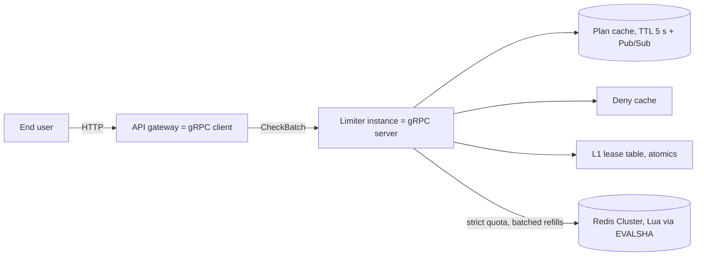

# Thesis plan: multi-tenant quota and rate limiting service (Oct 12 to Dec 15, 2026)

Exported from the shared planning doc on Oct 18, 2026. The day-to-day checklist with links to every
module is [ROADMAP.md](ROADMAP.md); the test list is [EVALUATION.md](EVALUATION.md). Use this file
for the reasoning behind the schedule: scope, hours, gates, what to cut first, and the writing plan.

| Week | Dates | Focus | Gate |
| --- | --- | --- | --- |
| 1 | Oct 12-18 | Redis client spike, cluster, Lua scripts, proto v1 | Both scripts pass every edge case; proto v1 agreed |
| 2 | Oct 19-25 | Strict engine end to end, baseline | Free customer stopped at exactly 200 via gRPC; baseline saved |
| 3 | Oct 26-Nov 1 | Lease fast path, batching, deterministic harness | Lease mode at least 4x strict; hit ratio at least 95% |
| 4 | Nov 2-8 | Overage, request ID, deny cache, leased quota, usage events | Request 2,001 gives three outcomes on three policies |
| 5 | Nov 9-15 | Reliability, metrics, open-loop load generator, Chapter 3 | Kill Redis, observe documented behaviour per plan |
| 6 | Nov 16-22 | Correctness evidence, TSan/ASan, freeze Nov 22 | All tests green; measured bound within derived bound |
| 7 | Nov 23-29 | Benchmark matrix, ablation, profile, Chapter 4 | Matrix, ablation table and flamegraph saved |
| 8 | Nov 30-Dec 6 | Scalability model, cost model, extrapolation, Chapter 5 | Full thesis draft by Dec 6 |
| 9 | Dec 7-15 | Advisor feedback, slides, demo, submit | Submit Dec 15 |

## Summary

The thesis builds a multi-tenant quota and rate limiting service. It enforces each customer's plan
exactly (free 200 requests/day, pay 2,000 requests/day) while the platform as a whole handles about
1M checks per second. The deadline is Dec 15, 2026: 9 weeks from Oct 12, about 140 working hours at
2.5 h a day with one rest day a week.

Assumptions to confirm: you develop in WSL2 Ubuntu with Docker on your laptop; your advisor accepts
the business framing; Dec 15 is the submission date for the full thesis, not the defense.

## The problem

Companies that sell an API sell request quotas by plan, and every call must answer one question in
real time: has this customer used what they paid for? A wrong answer either gives the product away
or blocks a paying customer. Managed gateways handle this only approximately: AWS states that usage
plan quotas are "not hard limits, and are applied on a best-effort basis"
([AWS docs](https://docs.aws.amazon.com/apigateway/latest/developerguide/api-gateway-api-usage-plans.html)).

The problem has two halves. Per customer it is a correctness problem: counts must be exact, survive
retries, apply upgrades immediately and reset at the same moment on every instance. Across the
platform it is a throughput problem: millions of tenants, floods from clients already over quota,
and a few enterprise keys hot enough to hit every limiter instance at once.

Thesis claim: the service enforces each tenant's quota exactly while handling about 1M checks/s
across the cluster, with a measured accuracy bound for the high-throughput burst path.

## Scope

| Tier | Items | Why |
| --- | --- | --- |
| Must | Proto v1 (`Check`, `CheckBatch`, `reason`, `reset_after_ms`, `request_id`); plan hash per customer; daily quota Lua (UTC day from Redis `TIME`, stores `used`); burst token bucket Lua; strict mode for quotas; L1 lease fast path for burst with single-flight and pipelined refills; overage `hard`/`grace`/`cap`; request ID dedup; local deny cache; fail-open/fail-closed per plan; Prometheus metrics; accuracy, flood and cardinality tests; benchmark report; thesis | These carry the claim: exact quotas plus high throughput |
| Should | Circuit breaker and Redis timeouts; backpressure with `RESOURCE_EXHAUSTED`; graceful shutdown returning leased tokens; health and readiness; SIGHUP reload; usage events to a log; TSan and ASan runs; fault tests | Expected of a production design; small once the core works |
| Bonus | Spring Boot demo gateway (HTTP 200 vs 429 live); one AWS run on separate machines | Strong for the defense; dropped first |
| Cut | Sliding-window algorithm (daily quota replaces it); file-watch reload; custom allocators; full fault-injection matrix; multi-region | High effort, low thesis value; listed as future work |
| Out of scope | Payment, invoices, user accounts, billing dashboard | Plans are seeded by an admin script |

## Architecture at a glance

Every API call reaches the limiter as one `CheckBatch` with two checks. The daily quota goes to
Redis exactly (unless the deny cache already knows the answer). The burst limit is served from the
local lease, which refills from Redis in pipelined batches.

## Timeline

Six build weeks lead to the Nov 22 freeze, thesis writing runs underneath the whole time, and the
final week (Dec 7 to 15) absorbs slips and advisor feedback.

## Week-by-week plan

Each week ends with a gate. If a gate is missed, cut that week's Should items before touching the
next week; never push the Nov 22 freeze. Hours are estimates at about 15 to 17 h a week.

### Week 1 (Oct 12 to 18): Redis, Lua and the API contract

- [x] Redis client spike (Day 1 to 2): confirm `redis-plus-plus` async cluster can pipeline `EVALSHA` and pool connections; decide, or fall back to `hiredis`, and write the justification.
- [x] Bring up the 3-master cluster and check slot routing with hash-tagged keys.
- [x] Daily quota Lua script: plan and usage under one hash tag, UTC day from Redis `TIME`.
- [x] Burst token bucket Lua script with a `requested` argument.
- [x] GoogleTest suite against real Redis: rollover, upgrade mid-day, downgrade, cost greater than limit, expiry.
- [x] Proto v1: your redesign, then review (`reason`, `reset_after_ms`, `request_id`).

Gate: both scripts pass every edge case; proto v1 agreed.

### Week 2 (Oct 19 to 25): Strict engine end to end

- [x] `RedisBackend`: async calls, `SCRIPT LOAD` at startup, `EVALSHA` with `NOSCRIPT` fallback.
- [x] Strict engine behind `RateLimiterCore`, wired into the gRPC server in place of the allow-all stub.
- [x] Plan seeding script writing `{cust:N}:plan` hashes for free, pay and enterprise customers.
- [x] Baseline benchmark with `ghz` on 1 instance; raw output in `results/`.
- [x] Thesis: Chapters 1 and 2 drafts.

Gate: a free customer is stopped at exactly 200 through gRPC; baseline numbers saved.

Status on Oct 17: Weeks 1 and 2 are done except the proto v1 review and the Chapter 1 and 2 drafts,
about a week early. The strict baseline is 25,301 checks/s (median of 5, 1,024 concurrent, p99 85 ms)
and 10,024 checks/s with p99 10 ms (64 concurrent). Start Week 3 now and spend the spare week on the
Should items below rather than moving the freeze.

### Week 3 (Oct 26 to Nov 1): Lease fast path for the burst rule (about 16 h)

Goal: burst checks served from local memory, Redis seeing only batched refills, and a test harness
that can prove the lease never breaks its bound.

- [x] **Lease table (4 h).** Sharded map from interned key id to a 64-byte-aligned lease; `TryTake` is a compare-and-swap loop. Interning turns the key string into a `uint64` once, so a hit allocates nothing and compares integers.
- [x] **Single-flight refill with early refill (2 h).** One refill in flight per key; others park. Refill starts when tokens fall below 30% of the last chunk, so most refills land before the lease is empty.
- [x] **Adaptive chunk size (2 h).** Double the chunk when the lease empties within one refill round trip, halve it when tokens sit unused, never above the cap (a fraction of capacity). Log every change so the thesis can plot chunk size against demand.
- [x] **Adaptive batcher (3 h).** Flush immediately when nothing is in flight and the queue was empty; otherwise collect until the batch is full or the timer fires. Compare against a fixed 200 µs timer: p50 at low load, throughput at high load.
- [x] **Deterministic test harness (2 h).** Fake Redis plus fake clock replying in seeded random order. Run thousands of seeds and assert admitted <= limit + N x C every time; a failing seed replays exactly.
- [x] **Microbenchmark ablation (2 h).** `TryTake` with and without `alignas(64)`, CAS vs `fetch_sub`, 1 vs 16 vs 64 shards, at 1, 4 and 16 threads, one hot key vs 10,000 keys. The false-sharing result is a figure for Chapter 4.
- [x] ThreadSanitizer on every lease test from the first commit.
- [x] Thesis (30 min a day): lease protocol notes and the first draft of the accuracy-bound derivation.

Gate: lease hit ratio at least 95% under the Week 2 load; 500 concurrent misses on one key cause exactly one refill; lease mode at least 4x the strict baseline of 25,301 checks/s on the same `ghz` command, with p99 under 2 ms at 10,000 checks/s offered.

Cut first if late: the adaptive batcher (keep the fixed timer and report it as future work).

### Week 4 (Nov 2 to 8): Business rules and leased quota for large plans (about 16.5 h)

Goal: the behaviour that makes this a quota service, plus the change that makes the 1M checks/s
argument hold: large plans no longer send every quota check to Redis.

- [x] **Overage policies and request ID in `quota.lua` (4 h).** `hard`, `grace`, `cap` with an `overage_used` counter; a retried request ID returns the stored result and is never counted twice. Week 1 tests must still pass unchanged.
- [x] **Deny cache (1.5 h).** After a quota denial, deny locally until the reset time Redis returned; cleared by plan-change messages.
- [x] **`CompositeCore` (3 h).** Order: suspended, deny cache, burst lease, quota, overage mapping. If the quota denies, give the burst tokens back. One test per branch of the decision tree.
- [x] **Plan cache with Pub/Sub invalidation (2 h).** TTL about 5 s as a safety net; measure how long an upgrade takes to reach every instance.
- [x] **Leased quota for large plans (3 h).** Rule setting `quota_mode: auto`: strict below a daily limit of about 100,000, leased above it with a chunk of at most 0.1% of the daily limit. Same lease machinery as burst, so the cost is a quota-lease variant of the script and a branch in `CompositeCore`.
- [x] **Usage events (2 h).** Bounded buffer, aggregated per customer per minute, flushed to a JSON-lines file every second; drops counted in a metric.
- [x] **`rlctl` admin tool (1 h).** Create, upgrade, downgrade, suspend, show.
- [x] Thesis: quota and overage section of Chapter 3, with the request 2,001 example and the product-decisions table.

Gate: request 2,001 gives three different outcomes on three policies; an enterprise customer on leased quota stays within limit + N x C in one quick run; every customer plan step B1 to B9 has a test or a written "described, not built" note.

Cut first if late: leased quota (keep all quotas strict and present it as the first future-work item, with the traffic argument).

### Week 5 (Nov 9 to 15): Reliability, observability and honest measurement (about 16 h)

- [ ] **Timeouts, circuit breaker, bounded retries with jitter (3 h).** 5 to 10 ms socket timeout; breaker opens after about 20 consecutive failures and sends one probe after 500 ms; retry only timeouts, at most twice. Unit-test the breaker with a fake clock.
- [ ] **Failure policy per plan (1.5 h).** After the lease runs out, paid plans fail open and mark the admission `unverified`; free plans fail closed with `UNAVAILABLE`.
- [ ] **Backpressure and graceful shutdown (2.5 h).** Bounded queues answer `RESOURCE_EXHAUSTED`; on SIGTERM set health to `NOT_SERVING`, drain, return unused leases with `return_lease.lua`, flush usage events.
- [ ] **Health readiness and SIGHUP reload (2 h).** Readiness follows the breaker; a bad config file is rejected and the old rules stay live.
- [ ] **Prometheus metrics (2 h).** Outcomes per plan, latency per path (lease, strict, deny cache), Redis latency, lease hit ratio, batch size and flush reason, breaker state, queue depth.
- [ ] **Open-loop load generator (3 h).** Sends at a fixed arrival rate and measures latency from the time each call was scheduled, not when it was sent. A closed-loop tool slows down when the server stalls and hides the stall from p99 (coordinated omission). Check whether `ghz --rps` is enough first; write the small C++ client only if not. Record latency in log-scale buckets; report p50, p99, p999.
- [ ] Thesis: Chapter 3 draft with the architecture diagram, accuracy-bound derivation and failure-mode table.

Gate: kill a Redis master during load and observe the documented behaviour per plan; latency at a fixed rate is measured open-loop.

Cut first if late: SIGHUP reload (a restart-based reload is acceptable for the thesis).

### Week 6 (Nov 16 to 22): Correctness evidence and feature freeze (about 16.5 h)

- [ ] **TSan and ASan clean across all tests (2 h).** Fix every report; never silence one with a sleep.
- [ ] **Property-based tests against a reference model (3 h).** Random sequences of checks, retries, upgrades, downgrades and day rollovers, run through `CompositeCore` on the fake backend and through a trivially correct in-memory model; every answer must match. Seeded so a failure replays.
- [ ] **Quota accuracy test (2 h).** Four instances, free and pay customers, 10% forced retries, repeated 20 times: exactly 200 and 2,000 admitted, zero duplicates in usage events.
- [ ] **Bound model versus measurement (3 h).** A short Python simulation of N instances leasing chunks of size C under a given demand predicts over-admission. Run the burst accuracy test for chunk caps of 1%, 5% and 10% and plot measured against predicted and against the worst case N x C. Agreement is evidence the derivation is right; disagreement is a finding to explain.
- [ ] **Flood and cardinality tests (2 h).** An over-quota client retrying flat out (count Redis calls saved by the deny cache); 1 million customer keys (throughput, latency, Redis memory per key).
- [ ] **Fault tests (3 h).** Kill a master, add 20 ms latency with toxiproxy, drop connections; record allowed, denied and unverified counts and recovery time per plan.
- [ ] **Noisy-neighbour test (1.5 h).** One tenant sends ten times its quota while others run normal load; report the others' p99 with and without the flood.
- [ ] **Nov 22: feature freeze, tag `v1.0`.** After this only fixes and measured performance changes.

Gate: all tests green in release, TSan and ASan; measured over-admission at or below the derived bound.

Cut first if late: noisy-neighbour test, then connection-drop faults (keep kill-master).

### Week 7 (Nov 23 to 29): Benchmarks, ablation and measured tuning (about 16 h)

- [ ] **Benchmark matrix (5 h).** One script runs engines (AllowAll, Strict, Leased, Composite) x instances (1, 2, 4) x chunk cap (1%, 5%, 10%) x key distribution (uniform over 1M keys, Zipf with a few hot keys, one hot key), open-loop, 5 runs per cell, median with min and max. Pin the load generator and instances to separate cores with `taskset`.
- [ ] **Ablation study (3 h).** Switch off one mechanism at a time: lease, batcher, early refill, adaptive chunk, deny cache, plan cache, cache-line alignment. Report throughput and p99 change for each. This answers "which idea matters how much".
- [ ] **Profile and fix the top one or two bottlenecks (4 h).** `perf` and a flamegraph at the plateau. Likely candidates, chosen only if the profile shows them: per-thread sub-leases for a hot key, protobuf arenas or pooled callbacks if `malloc` shows, fewer gRPC threads. Report before and after.
- [ ] **Cheap build-level wins, each measured (2 h).** LTO, profile-guided optimisation trained on the benchmark workload, `mimalloc` or `jemalloc` via `LD_PRELOAD`. One row each in the results table; keep only what helps.
- [ ] **Bonus (1 h).** Redis 7 Functions instead of `EVALSHA` scripts, same benchmark.
- [ ] Thesis: Chapter 4 (implementation) including the alignment and ablation figures.

Gate: matrix, ablation table and flamegraph saved in `results/`; every Chapter 5 table generated from them by a script.

Cut first if late: build-level wins, then the Redis Functions bonus.

### Week 8 (Nov 30 to Dec 6): Models, final numbers and the evaluation chapter (about 16 h)

- [ ] **Universal Scalability Law fit (2 h).** Fit throughput at 1, 2, 4 instances (and 1 to 8 worker threads) to separate contention from coordination cost; use the fitted curve, not a straight line, to project how many instances 1M checks/s needs and where scaling would stop.
- [ ] **Little's law cross-check (0.5 h).** In-flight requests should equal throughput x latency; a mismatch points at a measurement error before it reaches the thesis.
- [ ] **Capacity and cost model (2 h).** Instances and Redis masters for 1M checks/s from the fitted model and measured Redis calls per master; monthly cloud cost and cost per million checks, every price cited and dated.
- [ ] **Extrapolation to 1M checks/s (1 h).** Combine the traffic argument (most load is large plans on leases plus floods absorbed by the deny cache) with the fitted model; list every assumption. Never present it as a measurement.
- [ ] **Bonus: one AWS run** on separate machines (limiter, Redis, load generator), budget alarm first; reported separately from laptop numbers.
- [ ] **Thesis: Chapter 5 (8 h)** with one section per evaluation test, threats to validity and the extrapolation; finish `DESIGN.md` and `README.md`.

Gate: full thesis draft by Dec 6.

Cut first if late: the AWS run, then the cost model (keep instance counts without prices).

### Week 9 (Dec 7 to 15): Review and delivery

- [ ] Dec 7: full draft to your advisor; apply feedback as it arrives.
- [ ] Chapter 6 and polish: goal-by-goal results table, limitations, future work; proofreading, references, figure captions, faculty format.
- [ ] Reproducibility check: on a clean clone, one documented command rebuilds, runs the tests and regenerates every Chapter 5 table and figure.
- [ ] Slides (10 to 12) and a two-minute demo (free customer hits 429, upgrade, three overage policies, Redis master killed); record a backup video. Bonus: the Spring Boot gateway showing HTTP 200 and 429 live.
- [ ] Mock defense: a friend asks the 20 questions in the defense brief; time the answers and fix weak ones.
- [ ] Dec 15: submit.

## Performance and depth additions

Weeks 3 to 9 add eight performance items and eight depth items. Each is measured, and each week names
what to cut first so the Nov 22 freeze holds.

| Addition | Kind | Week | Tier | Expected effect | Measured by |
| --- | --- | --- | --- | --- | --- |
| Interned key ids | Performance | 3 | Must | No allocation or string compare on a lease hit | Microbenchmark, allocation count |
| Adaptive chunk size with cap | Performance | 3 | Must | Fewer refills for busy keys, less stranding for quiet ones | Refill rate, over-admission per cap |
| Adaptive batcher | Performance | 3 | Should | Lower p50 at light load, same throughput at heavy load | p50 and throughput vs fixed timer |
| Leased quota for large plans | Performance | 4 | Should | Removes one Redis call per request for enterprise traffic | Redis calls per check, accuracy test |
| Per-thread sub-leases for hot keys | Performance | 7 | Bonus, profile-driven | Less contention on one cache line | One-hot-key benchmark, 16 threads |
| Arenas or pooled callbacks | Performance | 7 | Bonus, profile-driven | Fewer allocations per check | Flamegraph before and after |
| LTO, PGO, mimalloc or jemalloc | Performance | 7 | Should | Typically a few to tens of percent | One row each in results table |
| Redis Functions vs scripts | Performance | 7 | Bonus | Possibly lower script overhead | Same benchmark, both modes |
| Deterministic seeded test harness | Depth | 3 | Must | Races and ordering bugs replay exactly | Thousands of seeds, invariant check |
| Alignment and contention ablation | Depth | 3 | Must | Shows false sharing with numbers | Microbenchmark figure |
| Open-loop load generation | Depth | 5 | Must | Honest p99, free of coordinated omission | Fixed-rate runs, latency from schedule time |
| Property-based tests vs reference model | Depth | 6 | Should | Correctness across random histories | Seeded random sequences |
| Simulated vs measured accuracy bound | Depth | 6 | Must | Validates the derivation | Plot of predicted, measured, worst case |
| Noisy-neighbour isolation | Depth | 6 | Should | Shows one tenant cannot hurt others' p99 | p99 of others with and without flood |
| Ablation study | Depth | 7 | Must | Contribution of each mechanism | Throughput and p99 delta table |
| USL fit and cost model | Depth | 8 | Should | Defensible projection to 1M checks/s | Fitted curve, instance count, cost per million |

## Evaluation plan

The tests check each half of the thesis claim separately: exact per-tenant quotas, then throughput.
Every run records hardware, instance count, Redis shards, chunk size, key distribution and the load
generator command, is repeated at least 5 times, and reports the median.

| Test | Setup | Pass condition or result reported |
| --- | --- | --- |
| Quota accuracy | 4 limiter instances, one free and one pay customer hammered from many clients, forced retries | Exactly 200 and 2,000 allowed; zero double counts |
| Plan changes and reset | Upgrade mid-day, downgrade, run across 00:00 UTC | Upgrade applies on the next request; reset happens once, at the same moment on every instance |
| Overage policies | Three customers on `hard`, `grace`, `cap` past their quota | Request 2,001 blocked, allowed free, allowed as overage; cap respected |
| Burst accuracy bound | One hot enterprise key from all instances, lease mode, several chunk sizes | Admitted stays within limit + instances x chunk; bound plotted against chunk size |
| Flood | An over-quota client retrying as fast as possible | Redis calls near zero thanks to the deny cache; latency of denials |
| Cardinality | Load spread over 1 million customer keys | Throughput, latency, Redis memory per key |
| Strict vs lease | Same load, both modes | Throughput and p50, p99, p999 for each |
| Scaling | 1, 2 and 4 limiter instances (bonus: AWS, separate machines) | Throughput per instance and closeness to linear |
| Faults | Kill a Redis master, add 20 ms latency, drop connections | Behaviour per plan's failure policy; recovery time |
| Ablation | Same load with one mechanism off at a time | Throughput and p99 change attributed to each mechanism |
| Noisy neighbour | One tenant at 10x its quota while others run normally | Others' p99 with and without the flood |
| Bound model check | Python simulation of leasing vs burst accuracy runs, caps 1%, 5%, 10% | Measured over-admission at or below predicted and worst case |
| Scalability model | USL fit over 1, 2, 4 instances and 1 to 8 threads | Contention and coordination coefficients; projected instances for 1M checks/s |

The extrapolation to 1M checks/s uses the measured per-instance throughput and the scaling result,
with every assumption written out. It is never presented as a measurement.

## Thesis writing plan

Write as you build: 30 minutes of every working day goes to the thesis, so December is review and
polish, not first drafts. Target 55 to 65 pages; check your faculty's required format first.

| Chapter | Content | Pages | Drafted in |
| --- | --- | --- | --- |
| 1. Introduction | API businesses and tiered plans, why best-effort quotas are not enough, goals (exact quotas, 1M checks/s, p99 < 2 ms), contributions | 4 to 6 | Week 2 |
| 2. Background and related work | Token bucket and fixed windows; Redis, Lua atomicity and Cluster; gRPC callback API; AWS usage plans, Kong, Unkey, Upstash, Envoy ratelimit compared | 8 to 10 | Weeks 1 to 2 |
| 3. Design | Architecture, data model (plan, quota, bucket hashes), quota and overage logic, lease protocol and accuracy bound, deny cache, idempotency, failure policies, capacity math | 12 to 14 | Week 5 |
| 4. Implementation | Lease map, single-flight, pipelining, threading, Lua scripts, reliability features, with key code excerpts | 8 to 10 | Week 7 |
| 5. Evaluation | Every test in the evaluation plan, the profile, threats to validity, the extrapolation | 12 to 14 | Week 8 |
| 6. Conclusion | Results against goals, limitations, future work (multi-region, monthly pools, billing integration) | 3 to 4 | Week 9 |

Keep raw benchmark output in `results/` with the exact command beside each file, generate every
figure from a script, and write each limitation down the day you meet it.

## Daily routine

Split each 2.5 h day into fixed blocks so you never start a session wondering what to do:

1. 10 min: read yesterday's note, pick one goal for today, write it in the log.
2. 90 to 100 min: deep work on one task, ending in one commit.
3. 30 min: thesis writing about what you built, why, and what you measured.
4. 10 min: commit, push, and write tomorrow's first step.

Working rules: run the tests before every push; never optimise without a benchmark or profile
number; if a task passes 1.5x its estimate, cut scope instead of extending it; keep one full rest day
a week, because Weeks 4 to 7 are the heaviest.

## Risks and fallbacks

| Risk | Likelihood | Fallback |
| --- | --- | --- |
| Redis client lacks good async cluster pipelining | Medium | Decide in Week 1; fall back to `hiredis` with your own event loop, or pipeline per node manually |
| Laptop cannot show 1M checks/s | High | Report per-instance and per-core numbers, show 1, 2, 4 instance scaling, extrapolate with stated assumptions |
| WSL2 and laptop noise (throttling, background apps) | Medium | Plug in, high-performance mode, 5 runs per test, report medians; check the p99 gap (10 ms at 64 concurrent vs the 2 ms target) for WSL/Docker overhead before Week 3 |
| Business rules grow beyond the plan | Medium | Keep three overage policies only; no monthly pools, no billing system |
| Lease races found late | Medium | Run TSan from Week 3, not Week 6 |
| Redis counters lost in failover break billing accuracy | Low | Usage events are the durable record; document reconciliation as future work |
| AWS cost or setup takes too long | Medium | It is a bonus: skip it and keep the laptop evaluation |
| Schedule slips over 3 days | Medium | Drop in this order: AWS run, demo gateway, Redis Functions, build-level wins, SIGHUP reload, noisy-neighbour test, fault tests beyond killing a node; never drop the accuracy test or the benchmark |

## Milestones and definition of done

- [x] Oct 11: skeleton builds and tests pass; concepts and business framing settled
- [ ] Oct 18: quota and token bucket Lua scripts pass all edge cases; proto v1 agreed
- [ ] Oct 25: strict engine end to end; free customer stopped at exactly 200; baseline measured; Chapters 1 and 2 drafted
- [ ] Nov 1: lease fast path with single-flight, adaptive chunks and adaptive batcher; seeded test harness passing
- [x] Nov 8: overage policies, request ID, deny cache, usage events and leased quota working (done Oct 19)
- [ ] Nov 15: reliability features, metrics and the open-loop load generator; Chapter 3 drafted
- [ ] Nov 22: feature freeze; TSan and ASan clean; property-based, accuracy and fault tests pass; bound model agrees with measurement
- [ ] Nov 29: benchmark matrix, ablation study and profile done; Chapter 4 drafted
- [ ] Dec 6: scalability model, cost model and extrapolation; full thesis draft
- [ ] Dec 15: advisor feedback applied; slides, demo and thesis submitted

The code is done when it builds with the release preset, all unit and integration tests pass, and
one documented command reproduces every benchmark table in the thesis.
