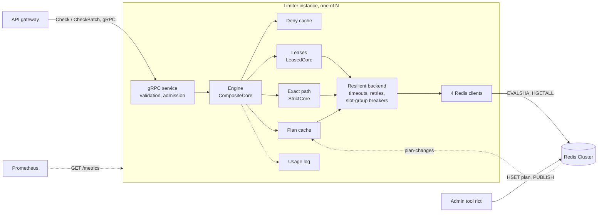

# Chapter 3. Design

> Drafted in Weeks 2 to 5: product decisions (3.1.3) in Week 2, the lease protocol (3.5) in Week 3,
> quota and overage logic (3.4) in Week 4, and the rest in Week 5 (complete draft 2026-10-22).
> Results still to come are marked **[Pending: Week N]**. Tables are numbered in reading order.

## 3.1 Requirements

The goals of Section 1.3 say what the service must achieve. This section turns them into
requirements that a test or a measurement can check: what the service does (3.1.1), how well it
must do it (3.1.2), and the product decisions that no technical argument settles (3.1.3).

### 3.1.1 Functional requirements

*Table 3.1: Functional requirements.*

| ID | The service must | Designed in |
| --- | --- | --- |
| F1 | answer `Check{key, rule, cost, request_id}` with a decision and the numbers behind it: allowed, reason, limit, remaining, retry and reset times | 3.2 |
| F2 | answer up to 1,000 checks in one `CheckBatch` call, each answer in the position of its request | 3.2 |
| F3 | decide one API call of a customer from one rule, `customer`: suspension, burst limit, then the daily quota under the plan's overage policy | 3.4 |
| F4 | take each customer's numbers from their plan in Redis, so that a plan change applies on the next call, without a restart, and keeps the day's usage | 3.3, 3.4.4 |
| F5 | count a call that carries a request id once within five minutes, and give its retries the first answer | 3.4.3, 3.6 |
| F6 | serve rules not tied to a plan with a token bucket, a fixed window or a sliding window | 3.3 |
| F7 | follow each plan's failure policy when Redis cannot answer, and mark calls admitted without being counted | 3.7 |
| F8 | write usage events per customer and minute, the record a billing system reads | 3.2 |
| F9 | reload its rules file without a restart, and keep the old rules if the new file does not load | 3.2.4 |
| F10 | report its readiness to a load balancer and its metrics to Prometheus | 3.2, 3.7.4 |

The API separates two kinds of "no". A decision is an answer: the call succeeds, and a reason says
what was decided. There are seven reasons (`OK`, `RATE_LIMITED`, `QUOTA_EXHAUSTED`, `OVERAGE`,
`SUSPENDED`, `UNAVAILABLE`, `UNVERIFIED`), which the gateway maps to HTTP: 429 for the two limits, 403
for a suspended account, 503 for `UNAVAILABLE`. A gRPC error means that no decision could be made:
`INVALID_ARGUMENT` for a malformed request (an empty key or rule, a key or request id longer than 128
bytes, a rule the configuration does not have) and `RESOURCE_EXHAUSTED` for an overloaded instance. A
Redis outage is deliberately an answer, not an error. The limiter applies the plan's failure policy
and says that it did, so a gateway never has to invent a policy of its own for a failure it cannot
see.

### 3.1.2 Non-functional requirements

*Table 3.2: Non-functional requirements, from the goals of Section 1.3, and their status after Week 5.*

| Goal | Requirement | Verified by | Status |
| --- | --- | --- | --- |
| G1 | a quota is never over-admitted, whatever the concurrency | 400 concurrent calls on a Free quota of 200 through gRPC admit exactly 200; evaluation test 1 with several instances | met: four instances, 20 of 20 runs exact (Free 200, Pay 2,200), 9,608 duplicate requests counted once |
| G2 | a retry with the same request id within five minutes is not counted again | script and gRPC tests (3.4.3) | met |
| G3 | a plan change applies on the next call and keeps the day's usage | mid-day upgrade test; 22 ms from the admin tool to two instances (3.4.4) | met |
| G4 | one reset instant, 00:00 UTC by the Redis clock | day-rollover test of the quota script; evaluation test 2 | met: yesterday's full counter resets once although two instances meet it at the same moment (`YesterdaysFullCounterResetsOnceForEveryInstance`); 34,425 rollovers in the property tests |
| G5 | about 1,000,000 checks per second on a cluster | an estimate from per-instance measurements (3.8), never reported as a measurement | estimated in 3.8 |
| G6 | p50 below 500 µs and p99 below 2 ms per check | latency at fixed arrival rates, measured at the client (an upper bound on the server-side figure) | met by leased rules up to 20,000 checks/s per instance (p50 0.43 ms, p99 1.45 ms; final build, `open_loop_2026-10-24.md`); at 40,000/s p99 3.30 ms. The full customer check meets the p99 at 5,000/s (1.88 ms) but not the p50 (0.94 ms): it needs two Redis round trips |
| G7 | over-admission of a leased limit at most N × C in any window | proof (3.5.3); seeded harness over 100,000 seeds; measurement on the cluster | proved and measured: at most 381.5 tokens against 400 at a 10% cap, a model within 0.3 tokens (3.5.4) |
| G8 | an over-quota flood is refused locally; an overloaded instance refuses at once | unit tests; microbenchmark of the deny cache (3.6.1); flood test | met: a flood of 74,881 denials a second cost 2 Redis calls in 10 s; p99 of a denial 0.61 ms at 10,000/s |
| G9 | documented behaviour per plan when Redis is slow or down | a master killed under load (3.7.3) | met |

Two further requirements apply to the code rather than to the service. Nothing on the lease hot path
takes a lock, allocates memory or writes a log line, because each of those would cost more than the
compare-and-swap that serves the check. And no change is called an optimisation without a measurement
before and after it; most sections of this chapter quote one.

### 3.1.3 Product decisions

Some requirements are not technical consequences but product choices: several answers would be
defensible, and the system must pick one and state why. Table 3.3 lists the six that affect how
quotas are counted. Each is enforced in one place, so changing a decision later changes one
component, not the whole design.

*Table 3.3: Product decisions.*

| Question | Decision | Rejected alternative |
| --- | --- | --- |
| When does the day reset? | 00:00 UTC for every customer | midnight in the customer's time zone |
| Does a call that fails with a server error count? | yes | refund the unit on a 5xx response |
| When does a downgrade apply? | at the end of the billing cycle | immediately |
| Is traffic admitted while Redis is unreachable billed? | no: it is marked unverified | billed like counted traffic |
| What if a customer has no plan hash? | treat the customer as Free | deny |
| How large is the grace allowance? | 10% of the daily quota, stored per plan | a fixed amount for every plan |

**Reset at 00:00 UTC.** The quota script derives the current day from the Redis clock as
⌊now / 86,400,000 ms⌋. Every limiter instance therefore agrees on the reset instant (goal G4), the
script needs no time-zone table, and no job runs at midnight: the first call of a new day sees a new
day number and starts from zero. Per-customer midnight would require a time zone in every plan,
would make "today" differ between customers, and would give some customers 23- and 25-hour days at
daylight-saving transitions. It is listed as future work.

**Server errors count.** The limiter decides before the call reaches the provider's service and
never sees its outcome. Refunding a unit after a 5xx response would need a second message from the
gateway after the response, adding a call per failed request and a new failure mode: a lost refund
message silently overcharges, a duplicated one undercharges. The call also did consume the
provider's capacity. A refund keyed by `request_id` is possible future work, which the API already
supports because every call can carry an id.

**Downgrades at the end of the cycle.** A customer has paid for the current cycle, and the quota
script reads the limit from the plan at the time of each call, so a downgrade is simply written to
the plan hash later, by the admin tool, when the cycle ends. If a downgrade does apply on a day
whose usage already exceeds the new limit, the script denies with `remaining = 0`, never a negative
number (`QuotaDowngradeBelowUsageDeniesWithoutNegativeRemaining`). An immediate downgrade would cut
service the customer has already paid for.

**Fail-open traffic is not billed.** When Redis cannot be asked and a plan fails open, the call is
admitted without being counted, and the response says so (`REASON_UNVERIFIED`). Billing such calls
would bill traffic that was never measured and might exceed the quota; the exactness promise of this
thesis covers counted traffic only. Usage events (Week 4) mark these calls `unverified`, so a billing
system can apply its own policy to them.

**A missing plan means Free.** A plan hash can be missing because a sign-up has not propagated yet,
or because of an operator error. Treating the customer as Free can give away at most the cheapest
plan, while denying would turn a data error into an outage and fail every new customer whose first
call races the sign-up. The same rule applies to individual fields: a missing or malformed field
takes its Free default (`plan_test.cc`).

**Grace of 10% of the quota.** A single rule is easy to state in a price list and to test: a Pay
customer with 2,000 calls per day may make 2,200 before being denied (the grace policy is built in
Week 4). The amount is stored per plan
in the `extra` field of the plan hash, written by the seed tool and the admin tool, so a plan can
carry a different allowance without a code change; 10% is the value of the shipped presets.

## 3.2 Architecture

### 3.2.1 Components

Figure 3.1 shows the processes that take part in a check: the provider's API gateway, N identical
limiter instances, and one Redis Cluster. Only Redis holds state that matters; everything an instance
holds can be lost.

*Figure 3.1: Components. Solid arrows are calls on the path of a check; dashed ones are not.*

**API gateway.** The gateway is outside the system built here; a small demo gateway
(`examples/gateway-python`) plays its part in the tests. It authenticates the end user's API key,
maps it to a customer id, and asks the limiter before it forwards the call: one `Check` naming the
`customer` rule per API call, or a `CheckBatch` of up to 1,000 checks. The limiter trusts the
gateway: it sees customer ids, never API keys, validates only the shape of each request, and is not
reachable from the internet.

**Limiter instances.** Every instance runs the same code and configuration and none talks to another.
What an instance holds is either a copy of Redis data (cached plans, local denials) or tokens Redis
granted it (leases), so adding an instance needs no coordination and losing one costs at most the
tokens it held, which makes the limiter briefly stricter. Inside an instance, a check passes four
layers:

1. The **gRPC service** validates each request at the trust boundary and admits at most 10,000
   checks at once (3.7.4). It uses gRPC's callback API: a check that waits for Redis holds a callback,
   not a thread.
2. The **engine** decides. `CompositeCore` handles the `customer` rule in the order of 3.4.1;
   `LeasedCore` serves rules not tied to a plan, and the quota of plans of 100,000 calls a day or more,
   from leases (3.5); `StrictCore` sends one script per check. The burst limit of a customer is a
   script per check today: leasing it per customer is future work.
3. **Shared local state**: the plan cache (3.4.4), the deny cache (3.6.1) and the usage log, which
   sums each customer's outcomes per UTC minute in 16 lock-free rings and appends one JSON line per
   sum to a file every second, the durable record a billing system would read.
4. **Redis access**: the resilient backend of 3.7.2 (timeouts, retries, breakers per slot group) in
   front of four redis-plus-plus cluster clients, each with its own I/O thread, keys spread over
   them by hash. Scripts are sent as `EVALSHA` with a SHA1 computed locally; a node that does not know
   the script yet answers `NOSCRIPT`, and the call is sent once more with the source.

**Redis Cluster.** The only shared state and the only source of truth: plans, counters, token buckets
and stored answers. Each script runs atomically on the master that owns its keys, and all the keys of
one customer carry the customer's hash tag, so one script touches one node and needs one round trip.
Scripts read the clock of that node, so every instance agrees on the time and on the UTC day. The
development cluster has three masters; the fault tests add a replica to each.

**Admin tool.** `rlctl` writes a customer's plan hash and then publishes the customer id on the
`plan-changes` channel, which every instance subscribes to (3.4.4). It stands in for the provider's
account and billing systems, which are out of scope.

### 3.2.2 The path of one check

Take `Check{key: "cust:42", rule: "customer"}` for a Pay customer.

1. A gRPC thread receives the call. The service validates it and counts it as in flight.
2. The plan comes from the calling thread's own copy (no lock), else from the shared cache, else
   from one `HGETALL` that every check of this customer waiting at that moment shares.
3. A suspended plan, or a denial in the deny cache, answers at once without Redis.
4. The burst script runs on the master that owns `{cust:42}`. A denial answers `RATE_LIMITED`.
5. The quota script runs on the same master. For a plan of 100,000 a day or more, a lease of the
   day's counter answers instead, and Redis is asked only to refill it.
6. The Redis I/O thread that received the reply builds the answer, finishes the RPC, records the
   metrics, and records a usage event.

A Pay or Free customer's check therefore costs two Redis round trips, one after the other (one when
the burst limit denies), plus a plan read every five seconds per instance; an enterprise customer's check costs one, plus refills; and a
check of a leased rule such as `api_default` costs none when its lease holds tokens, and is then
answered on the gRPC thread itself. Both of a customer's keys live on one master, so a single script
could check burst and quota in one round trip. The design instead moves the burst limit towards a
per-customer lease, which removes its round trip altogether.

No thread waits for Redis. Table 3.4 lists the threads of an instance.

*Table 3.4: Threads of a limiter instance.*

| Thread | Count | Work |
| --- | --- | --- |
| gRPC callback threads | gRPC's pool | receive, validate, admit; answer lease hits and local denials inline |
| Redis I/O threads | 4 | send scripts, receive replies, run the engine's callbacks, finish RPCs |
| Retry timer | 1 | sends timed-out calls again after their jittered delay (3.7.2) |
| Plan listener | 1 | the `plan-changes` subscription |
| Usage flush | 1 | sums the usage rings and appends to the usage file, once a second |
| Metrics | 1 | answers `GET /metrics` |
| Main | 1 | signals, readiness, rule reload, shutdown |

### 3.2.3 Rules and plans

A deployment's rules file says which limits exist and how each is decided; a customer's plan in
Redis says how large their limits are (3.3). The split follows how often each changes. Plans change
whenever a customer signs up, upgrades or stops paying, so they live in Redis and every instance
reads them through the plan cache. Rules change when the provider changes its product, so they live
in a file shipped with the deployment.

### 3.2.4 Reloading the rules

On SIGHUP an instance reads its rules file again without a restart. The signal handler only sets a
flag; the main thread, which reads it every 100 ms, parses the whole file first. A file that does not
load is logged and changes nothing. Otherwise the main thread builds a new engine from the new rules
and switches the gRPC service to it with one atomic pointer store. Checks from then on use the new
engine, while a check already inside the old one finishes there. One second later the old engine
gives its unused leased tokens back to Redis, as at shutdown, and it is kept until the process
exits, so no check can ever reach a freed engine.

Swapping the whole engine, rather than the rule table inside it, follows from the lease table: every
lease refers to the rule it was made for, and engine callbacks hold references into the table, so a
table that changed under them would leave leases serving old rules. A new engine keeps each table
immutable for its whole life. Its costs were measured under an open-loop load of 10,000 checks per
second (`docs/thesis/evidence/reload_2026-10-22.md`). Nine reloads, six that applied and three
rejected files, failed no call. A pass with three reloads in 24 seconds had a p99 of 1.33 ms, against
0.72 ms without, because the new engine starts with no leases and each key's first check after the
switch waits for one refill. Reading the engine through an atomic pointer cost nothing measurable per
check: 63,366 against 63,681 checks per second for the gRPC service alone, before and after the
change (medians of eight alternating runs). The memory of a replaced engine, about 8 MB of lease
table plus its leases, stays until the process exits; an instance reloaded hundreds of times should
be restarted.

## 3.3 Data model

Three kinds of data decide a check: rules, which are templates in a file; plans, one per customer in
Redis; and counters in Redis, which only the scripts write. Instances keep local copies and grants
of these (3.3.4).

### 3.3.1 Rules

*Table 3.5: Fields of a rule (`config/rules.yaml`).*

| Field | Values | Meaning |
| --- | --- | --- |
| `algorithm` | `token_bucket`, `fixed_window`, `sliding_window`, `quota` | the Lua script that decides |
| `limit` or `limit_from` | a number, or `plan.daily` / `plan.burst` | where the limit comes from: the file, or the customer's plan |
| `refill_per_sec`, `window_ms` | numbers | a token bucket's refill rate; a window's length |
| `strict` | `true` or `false` | one script per check, or served from a lease |
| `lease_chunk_pct` | 1 to 100, default 10 | a leased rule's chunk cap C, in % of the limit: the knob of the bound N × C (3.5.3) |
| `quota_mode` | `strict` or `auto` | `auto`: plans of 100,000 a day or more lease their quota (3.4.5) |
| `failure_policy` | `fail_open` or `fail_closed` | when Redis cannot answer, for a rule not tied to a plan |
| `burst`, `quota` | two rule names | a customer rule: the two rules it combines (3.4.1) |

The shipped file has eight rules: `daily_quota`, `burst` and `customer` for customers;
`api_default`, a leased token bucket not tied to a plan; `login_attempts`, a strict sliding window;
and three small demonstration rules. A file is checked as a whole when it loads, and the first
inconsistency names the rule and the field: `plan.daily` only with the quota algorithm, `plan.burst`
only with the token bucket, a quota rule must be strict, and a customer rule's two names must exist
and be a token bucket and a quota. An instance with a bad file does not start; on a reload it keeps
its old rules.

### 3.3.2 Plans

A plan is a Redis hash, `{cust:42}:plan`, written by the admin tool.

*Table 3.6: Fields of a plan hash.*

| Field | Meaning | Default |
| --- | --- | --- |
| `plan` | the plan's name; `suspended` denies every call | `free` |
| `daily` | daily quota, in cost units | 200 |
| `burst`, `refill` | the burst bucket's capacity and refill per second | 2, 2 |
| `overage`, `extra` | the policy at the quota (`hard`, `grace`, `cap`) and its amount | `hard`, 0 |
| `failure` | when Redis cannot answer: `open` admits as `UNVERIFIED`, anything else denies | closed |

A missing hash, and any missing or malformed field, takes the Free default (3.1.3). The defaults are
deliberately the cheapest plan: a broken plan can never give away more than Free. Table 3.7 lists the
presets shipped with the admin tool; they are product choices, kept in one file (`tools/plans.sh`).

*Table 3.7: Plan presets.*

| Plan | Daily quota | Burst (capacity, refill/s) | At the quota | Redis down |
| --- | --- | --- | --- | --- |
| `free` | 200 | 2, 2 | hard: deny until 00:00 UTC | fail closed |
| `pay` | 2,000 | 20, 20 | grace: 10% more free, then deny | fail open |
| `pay_cap` | 2,000 | 20, 20 | cap: up to 1,000 billed overage | fail open |
| `enterprise` | 1,000,000 | 2,000, 2,000 | cap: up to 100,000; quota leased in chunks of 1,000 | fail open |
| `suspended` | 0 | 0 | always deny, `SUSPENDED` | deny |

### 3.3.3 Counters in Redis

*Table 3.8: Keys in Redis.*

| Key (example) | Type and fields | Written by | Expires |
| --- | --- | --- | --- |
| `{cust:42}:plan` | hash: the fields of Table 3.6 | admin and seed tools | never |
| `{cust:42}:daily_quota:q` | hash: `day`, `used`, `overage_used` | `quota.lua` | end of the UTC day + 1 h |
| `{cust:42}:burst:tb` | hash: `tokens` (in thousandths), `last_refill_ms` | `token_bucket.lua` | when the bucket would be full again, + 1 s |
| `{cust:42}:daily_quota:req:<id>` | string: the stored answer | `quota.lua` | 5 minutes |
| `{user:42}:demo_fixed_window:fw` | string: the current window's count | `fixed_window.lua` | end of the window |
| `{user:42}:demo_sliding_window:sw` | hash: the current and previous windows' counts | `sliding_window.lua` | from the window length |

Five choices shape these keys.

- **The hash tag is the limited entity.** Redis Cluster places a key by the part in braces only, so
  every key of one customer is on one master and one script may touch several of them atomically, as
  the quota script does with the counter and the stored answer. Gateways send the customer id, never
  a key, so the key format exists in one place in the code.
- **Rule and algorithm in the name.** Several rules of one algorithm can coexist for a customer, and
  a rule whose algorithm changes starts from fresh state instead of misreading state of another shape.
- **`used`, not `remaining`.** The limit arrives with every call, read from the current plan, so a
  plan change rewrites no counter (3.4.1).
- **Integers.** A bucket holds thousandths of a token, and a refill adds elapsed milliseconds times
  the rate, so millions of refills accumulate no rounding error.
- **The Redis clock and a lifetime on every write.** Scripts read the clock of the node that owns the
  key, so instances with skewed clocks cannot disagree about the day; elapsed time is clamped at zero
  in case a replica promoted after a failover runs behind. Every key but the plan expires on its own,
  so Redis memory follows the active customers, not every customer ever seen.

### 3.3.4 State on an instance

*Table 3.9: What an instance holds, and what losing it costs.*

| State | Size | If the instance crashes |
| --- | --- | --- |
| Lease table | 2^20 slots (8 MB) and a 192-byte lease per (rule, key) seen; never evicted | granted tokens not yet used are lost: stricter, never looser |
| Plan cache | one entry per customer seen recently (expired ones are swept as it grows), plus 256 recent plans per thread | read again from Redis |
| Deny cache | one entry per customer denied today | the next call asks Redis, which denies too |
| Usage rings | 16 bounded rings, flushed every second | up to one second of usage events |

Nothing in the table has to be recovered after a crash: each entry is either derived from Redis or a
grant that Redis has already subtracted. The one cost is in the usage file, the record of what each
customer used, which can miss the last second of a crashed instance. The lease table is the one
structure that grows with the number of keys and never shrinks; evicting idle leases needs safe
memory reclamation and is future work.

## 3.4 Quota and overage logic

### 3.4.1 One rule per API call

A gateway asks one question per API call: `Check{key: "cust:42", rule: "customer"}`. The `customer`
rule names two others, a token bucket for the burst limit and a quota for the daily limit, and the
engine reads the customer's plan once and decides in a fixed order:

1. **Suspended plan:** deny with `SUSPENDED`. No script runs, and waiting does not help.
2. **Local denial:** if this instance recently learned that the customer is out of quota, deny with
   `QUOTA_EXHAUSTED` and the reset time it learned. No script runs (3.4.4).
3. **Burst:** take a token from the burst bucket. A denial answers `RATE_LIMITED` at once.
4. **Daily quota:** count the call against the day under the plan's overage policy (3.4.2). If the
   quota denies, the burst token taken in step 3 is given back.

The order follows from what each answer costs and means. A suspended account and a known denial cost
no Redis call, so they come first. Burst comes before the quota because a call refused for burst must
not consume daily quota: the customer did not get the service. The give-back in step 4 is the
mirror case. Without it, a customer over quota would drain their own burst bucket with denied calls
and later be told `RATE_LIMITED` instead of the true reason, `QUOTA_EXHAUSTED`, which tells the
client to wait for the reset rather than retry in a second.

The quota script stores what was used, not what remains, and receives the limit from the current plan
on every call (3.3). A plan change therefore rewrites no counter: an upgrade from 200 to 2,000 a day
turns 200 used into 1,800 remaining on the next call, and a downgrade below today's usage denies with
`remaining = 0`, never a negative number.

### 3.4.2 Overage policies

What happens at the limit is a product choice, so the plan carries it as a policy and an amount
(`overage` and `extra` in the plan hash):

- **hard** denies at the limit until 00:00 UTC.
- **grace** allows `extra` more units free of charge, then denies. The shipped Pay plan has a grace of
  10% (3.1.3).
- **cap** allows up to `extra` units of billed overage and marks each such call `OVERAGE`. The script
  counts overage in a second field, `overage_used`, so the plan's own counter never passes the limit
  and billing reads the overage directly. A call that straddles the limit (cost 2 with one unit
  left) bills only the part beyond it.

Request 2,001 of a plan of 2,000 a day shows the difference. Table 3.10 gives the answer of the same
call on three customers whose plans differ only in the policy.

*Table 3.10: Request 2,001 on three overage policies (2,000 used, plan of 2,000 a day).*

| Policy | Shipped plan | Answer to request 2,001 | State after it |
| --- | --- | --- | --- |
| hard | Free | denied, `QUOTA_EXHAUSTED`, retry at 00:00 UTC | used 2,000 |
| grace, extra 200 | Pay | allowed, `OK`, remaining 0 | used 2,001; denied after 2,200 |
| cap, extra 1,000 | Pay with cap | allowed, `OVERAGE` | used 2,000, overage_used 1; denied after 1,000 more |

Grace answers `OK`, not `OVERAGE`, because the extra units are free: the reason field tells the
gateway what to bill, and only cap overage is billed. That choice is also what gives request 2,001
three different answers, which is the Week 4 gate. It is tested on the script alone and end to end
through gRPC (`Request2001GivesThreeAnswersOnThreePolicies`). Both counters reset with the UTC day,
derived from the Redis clock so every instance agrees on the reset instant.

### 3.4.3 Retries counted once

A gateway that times out and retries must not charge the customer twice, and must give the client
the same answer as the first attempt. A call may carry a `request_id`. The quota script then stores
its answer under a key with the customer's hash tag, `{cust:42}:daily_quota:req:<id>`, for five
minutes, in the same atomic script call that counts the usage. A retry with the same id gets the
stored answer, denials included, and is not counted again. The answer is marked `replayed`, so the
retry produces no second usage event and a replayed denial, decided under the plan of the first
attempt, is not cached locally under a plan that may have changed since. Storing the answer rather
than a "seen" flag matters: a retry of a denied call must be denied too, even if the customer was
upgraded in between.

Two limits remain. Burst is not deduplicated: a retry is still traffic, and it takes a burst token.
And the local denial of 3.4.4 answers before Redis, so a retry of a call that was allowed, arriving
after the quota ran out on that instance, is denied. It is not counted twice, but its answer differs
from the original.

### 3.4.4 Local denials and plan changes

After a `QUOTA_EXHAUSTED` answer the instance remembers the customer until the reset time Redis
returned, so further calls are denied without a Redis call and the local entry ends exactly when the
Redis counter does. Each entry keeps a stamp of the plan's quota terms (daily limit, policy, extra).
A call under a different plan ignores and drops the entry, so an upgrade lifts the denial on the next
call even if no plan-change message arrives.

Plans themselves are cached on each instance for five seconds, which removed the plan read from
every call: on the Week 2 strict benchmark the cache alone raised throughput from 16,738 to 19,480
checks per second (median of five runs each, same session). The admin tool writes a plan, then
publishes the customer id on a Pub/Sub channel, and every instance drops its cached plan and its local
denial. A read in flight when the message arrives is discarded and sent again, because it may have
read the old plan. An instance that loses its subscription drops every cached plan when it
reconnects, because Pub/Sub keeps no messages for an absent subscriber. A plan change therefore
applies within the delay of the message, measured at 22 ms from starting the admin tool until two
instances held the new plan, and within the five-second TTL if a message is lost while the
connection looks healthy.

### 3.4.5 Leased quota for large plans

An exact quota costs one Redis call per check, which is the right price for small plans: one chunk
of a 200-a-day quota would be a visible share of the day. For a large plan it is not. A plan of
100,000 calls a day or more therefore takes its daily quota from a lease, with the protocol of 3.5
and a smaller chunk: at most 0.1% of the daily limit, so C = 1,000 for the enterprise plan of
1,000,000. The lease is refilled by the quota script itself, with the chunk as the cost and the hard
policy, so a lease only ever takes units inside the plan. When the day's counter has less than a
chunk left, the lease takes what is left and then denies locally until the reset; a call it denies
goes to the exact path, which applies the plan's overage policy and request id. Overage, which is
billed, is therefore always counted exactly.

The bound of 3.5.3 applies with no refill during the day. Redis grants at most `limit` units in a day.
Units leased before midnight and used after it were counted for the old day, so N instances admit at
most limit + N × C in one day: 0.4% of the day for four instances. Units leased and not used before
the reset are an under-admission of at most N × C. In the gate test four instances shared one
customer of 100,000 a day (C = 100) with 20% more demand than the bound allows. They admitted exactly
100,000 units, with 1,253 quota calls for 12,048 checks instead of one per check. A leased call does
not deduplicate request ids: a retry inside the plan counts again and uses up one more unit of the
plan, though the retry itself is never billed as overage.

The accuracy of leased quota under faults and over a day boundary was tested by the property tests:
over 80,490 simulated days with outages and rollovers, Redis never granted beyond the plan, and N
instances admitted what Redis granted minus at most N × C held in leases (5.2).

## 3.5 Lease protocol and the accuracy bound

### 3.5.1 Why leases

A strict check costs one Redis round trip, and its throughput on one instance is bounded by how many
round trips are in flight: the Week 2 baseline admits 10,024 checks per second at a p99 of 10.5 ms
with 64 concurrent calls, and needs 1,024 concurrent calls to reach 25,301. The burst limit is
checked on every API call, almost always for customers far below their limit, so most of those round
trips only confirm that tokens remain. A lease removes them: each limiter instance takes a share of a
customer's token bucket from Redis in advance and admits checks against it in its own memory, asking
Redis again only when the share runs low. The cost is accuracy: tokens one instance holds are
invisible to the others. This section defines the protocol, states the invariant it maintains, and
derives the bound on the over-admission that invariant allows.

### 3.5.2 The protocol

A *lease* is the set of tokens of one (rule, key) bucket that one instance has already taken from
Redis. Redis remains the owner of the bucket: it refills the bucket over time with `token_bucket.lua`
and grants tokens to leases on request, atomically.

1. **Hit.** A check of cost c takes c tokens from the lease with one compare-and-swap that never lets
   the count fall below zero. It takes no lock, allocates no memory and sends nothing to Redis.
2. **Single-flight refill.** At most one refill per lease is in flight. A check that finds the lease
   empty is parked; when the refill lands, the parked checks are answered in arrival order. Five
   hundred concurrent misses on one key cause exactly one refill (tested).
3. **Early refill.** A hit that leaves less than 30% of the current chunk starts a refill, so a key
   under steady load never waits for Redis.
4. **Top-up.** A refill asks Redis for `target − tokens held`, where the target is the chunk (or the
   cost of a parked check, if larger). After it lands, the lease holds at most one chunk.
5. **Large checks.** A check whose cost exceeds the chunk cap C skips the lease and is checked in
   Redis directly, on the same bucket.
6. **Adaptive chunk.** The chunk starts at the cap C = max(1, ⌊limit × p / 100⌋), where p is the rule's
   `lease_chunk_pct` (10 by default), and changes once per full
   refill: it doubles when checks found the lease dry while the refill was out, because demand
   outran one chunk within one round trip, and halves when the previous chunk lasted more than ten
   seconds, because its tokens sat unused where no other instance could use them. It never leaves
   [min(8, C), C].
7. **Denial.** When Redis reports the bucket empty, the lease denies locally until the retry time
   Redis returned, so a client hammering an empty bucket costs no further Redis calls.

### 3.5.3 Invariant and bound

**Invariant.** At any moment an instance holds at most C tokens of one bucket, apart from the instant
between a refill landing and the parked check that asked for those tokens taking them.

Steps 4 and 5 exist to keep this invariant; 3.5.4 explains how its absence was found.

**Theorem.** Let N instances serve one bucket of capacity `limit` and refill rate r, each holding at
most C tokens. Over any interval [a, b], the tokens admitted satisfy

    admitted(a, b) ≤ limit + r·(b − a) + N·C.

*Proof.* Every token admitted during [a, b] was either held by some instance at time a, or granted
by Redis during [a, b]: leases only hand out tokens that Redis granted. By the invariant, the
instances hold at most N·C tokens at a. Redis executes each grant atomically against the bucket,
which contains at most `limit` tokens at a and gains r·(b − a) during the interval, so it grants at
most limit + r·(b − a). Adding the two bounds gives the result. ∎

An exact token bucket admits at most limit + r·(b − a) over the same interval, so the over-admission
caused by leasing is at most **N × C in any window**. It is temporal, not cumulative: tokens taken
from Redis earlier are spent later, but no token is ever created, so over a whole day the leases
admit no more than Redis granted. The tuning rule follows directly: the cap is chosen from the
over-admission one can accept. With four instances and the default 10% cap, a burst limit of 1,000
may admit up to 400 extra checks in a window, and a cap of 1% would reduce that to 40 at the cost of
ten times more refills. Each rule sets its own cap (`lease_chunk_pct`, 3.3.1); 3.5.4 measures both.

### 3.5.4 Evidence: a seeded harness

The theorem holds only if the implementation keeps the invariant, which is hard to see in concurrent
code. A deterministic harness checks it. One to four engine instances share a fake Redis that executes
the arithmetic of `token_bucket.lua` (milli-tokens, a millisecond clock, refill on use) at the
moment it answers a call. It answers pending calls in an order drawn from a seeded random generator,
fails 2% of them, and runs under a fake clock that advances by milliseconds with occasional jumps of
up to three seconds. Each seed draws a limit between 10 and 2,000, a refill rate, and checks of cost 1
to 5 on up to three keys, then verifies the theorem over every window of admissions in one pass
(prefix sums of admitted cost, with a running minimum). A failing seed prints itself and replays
exactly.

The harness found two violations in the first version of the protocol:

1. The early refill added a full chunk on top of the up to 30% still in the lease, so an instance
   could hold 1.3 × C. Seed 1177 (N = 2, C = 9) admitted 18.79 tokens over the exact bucket in one
   window, against a bound of 18. The top-up rule (step 4) fixed it.
2. A check costing more than C made the lease hold more than C, through refills sized for it and
   through partial grants it could not use. Seed 4388 (N = 2, C = 1, costs up to 5) admitted 2.7 over
   the exact bucket against a bound of 2. Routing such checks to Redis (step 5) fixed it.

With both fixes, 100,000 seeds (165 million checks) keep the bound, and the worst window reaches
exactly N × C: the bound is tight, not merely safe.

The bound was then measured on the cluster (evaluation tests 4 and 12,
`docs/thesis/evidence/burst_bound_2026-10-22.md`). Four instances served one hot key of a bucket of
1,000 tokens refilled at 100 a second, at chunk caps of 1%, 5% and 10%, under two demands of 2,000
calls a second. The first was a burst after an idle period, the worst case the proof allows: the
leases are full and the bucket has refilled. The second was steady overload. The over-admission was
taken from the allowed answers as the largest excess over any exact bucket in any window, and the same
calls were replayed through a simulation of the protocol written independently of the engine.

*Figure 3.2: Over-admission against the chunk cap, measured (median of five runs) and predicted, with
the worst case N × C.*

After an idle period the burst admitted 34.7, 189.0 and 381.4 tokens more than any exact bucket
could (medians of five runs), against bounds of 40, 200 and 400. Each instance held C − 1 tokens
after its warm-up check, so about N × (C − 1) was expected, a little less because part of the
bucket's refill lands within the window. Under steady overload the excess was at most zero, and the
leases admitted slightly fewer calls than an exact bucket would have. The simulation predicted 34.4,
188.8 and 381.4, and its admitted counts matched the measurement exactly in 29 of 30 runs. The cap is
therefore a measured knob: on four instances, a cap of 1% bounds a burst to 35 extra tokens and 10% to
381, at the price of about one Redis call per C checks.

### 3.5.5 Alternatives considered

- **No lease (strict checks only).** Exact, but one Redis round trip per check: rejected for the
  burst limit by the throughput argument of 3.5.1, kept for the daily quota where exactness is the
  product.
- **Adding a full chunk at the watermark.** Simpler, and up to 30% fewer refills than the top-up, but
  it breaks the invariant (3.5.4). The top-up costs refills of 0.7 to 1.0 × C instead of exactly C,
  at most 43% more of them. Measured under load (one instance, 192 in flight, 3 runs), the mean
  top-up was 0.87 of the chunk over Zipf keys on 10,000 keys, so 14.3 to 14.7% more refills. Over
  1,000,000 keys it was 0.994, so 0.6% more, because nearly every refill fills an empty lease
  (`rl_lease_topup_tokens_total`).
- **`fetch_sub` instead of a compare-and-swap loop.** Measured 2.5 to 2.7 times faster on one shared
  lease under contention, but a failed take must be undone, and while it is undone another thread
  can be denied although tokens exist. The compare-and-swap never lets the count go negative.
  Rejected unless a profile of the real server shows the take on its critical path.
- **Cooperative client-side leases**, as in Doorman [9]. They remove the shared store from the hot
  path but trust clients to respect their grants. Here the lease holders are the limiter instances
  themselves, so the tokens are enforced and the bound holds by construction.
- **Starting chunks at the minimum** (8 tokens) and growing them. Only a dry lease doubles a chunk,
  and with early refills a steadily used lease is never dry, so a moderately busy key would stay near
  the minimum. Its checks would rarely wait, but one in eight would cost a Redis call. Starting at
  the cap and halving idle chunks keeps a key at 3 checks per second near 25 tokens: one Redis call
  per 25 checks.

## 3.6 Deny cache and idempotency

Sections 3.4.3 and 3.4.4 described what the two mechanisms do for a customer. This section describes
how they are built and what they cost, since both sit on the path of every customer check.

### 3.6.1 Deny cache

A customer over quota who keeps calling, a client stuck in a retry loop for instance, must not cost a
Redis call per attempt (goal G8). After the first `QUOTA_EXHAUSTED` answer, an instance therefore
answers that customer itself until the reset.

**Structure.** The cache has 64 shards, each on its own cache line, with a hash map under a mutex and
an atomic count of the map's entries. An entry holds the instant the denial ends, computed from the
reset time Redis returned, and the stamp of the plan it was made under (3.4.4). A lookup hashes the
customer id to a shard and first reads that count. Few customers are over quota at any moment, so
almost every lookup finds a shard with no entries and returns after that one atomic load, without the
lock; only a shard that holds a denial is locked and searched.

**Cost.** In the microbenchmark on 16 threads (`results/2026-10-18_customer_microbench`), the lookup
that finds no denial runs at 2,089 million lookups per second in total, against 12.2 million when
every lookup took the shard's mutex. A flood, every thread looking up one denied customer, contends
on one shard's mutex and runs at 9.7 million lookups per second, more than 100 times the gRPC rate of
one instance (82,565 calls per second with no limiter at all), so a flood is answered locally without
becoming the bottleneck. The flood test confirmed it on the server (evaluation test 5,
`docs/thesis/evidence/flood_cardinality_2026-10-22.md`). One customer out of quota, retrying flat out,
was denied 74,881 times a second, the instance's rate for any check, and cost Redis two calls in ten
seconds, both of them plan re-reads. At a fixed 10,000 calls a second a denial took 0.24 ms at the
median and 0.61 ms at p99. The lock stays.

The cache holds quota denials only. A tenant within its daily quota but far over its burst limit
gets `RATE_LIMITED` from the burst script, one Redis call per attempt. In the noisy-neighbour test
(evaluation test 11, `docs/thesis/evidence/noisy_neighbour_2026-10-23.md`), one such tenant at 20,000
calls a second raised its master's load from 3,319 to 25,233 calls a second, and the other tenants'
p99 from 4.5 to 31 ms; their answers stayed right. The same flood over quota cost Redis nothing.
Leased rules already deny locally until the retry time Redis returned (3.5.2, step 7), and the same
local denial for the customer's burst check is the fix. It is future work, because the retry time
depends on the cost that was denied.

**Correctness.** A denial recorded at the moment of a lookup in the same shard can be missed once;
that check then asks Redis, which denies too, so the cache can make an answer slower but never looser.
Instances do not share denials: each learns one from its own `QUOTA_EXHAUSTED` answer, so N instances
cost at most N extra quota calls per customer after the quota runs out, and none after that until the
reset. Expired entries are dropped when a shard grows past a threshold that doubles with the number
of entries left, so the memory follows the customers denied today, not every customer ever denied.

**Alternatives.** Asking Redis every time is exact and simple, but it multiplies the cost of the
round trip by the rate of the flood, which is the cost the cache exists to remove. A deny list
shared by the instances would let one denial serve all of them, at the price of messages between
instances, which this design otherwise avoids entirely.

### 3.6.2 Idempotency

**Mechanism.** A call that carries a request id has its answer stored under
`{cust:42}:daily_quota:req:<id>` for five minutes, by the quota script, in the same call that counts
it. The key carries the customer's hash tag, so it lives on the same master as the counter, and Redis
runs the script atomically: the call is counted and its answer stored, or neither happens. No moment
exists at which a retry could find the call counted but no answer stored.

**Alternatives rejected.**

- *Recording the id first*, with `SET NX`, then counting: two round trips, and a failure between them
  leaves an id recorded for a call that was never counted, so its retry passes free.
- *Deduplicating in the limiter's memory*: a retry may reach a different instance.
- *Deduplicating in the gateway*: the retry may come from the client behind the gateway, through
  another gateway instance.

**Cost.** One stored answer costs 181 bytes of Redis memory: 100,000 answers of the real format,
written to one master of the development cluster, raised its memory by 18.1 MB (Redis 7.4.11,
2026-10-22). The memory held is the rate of calls that carry an id, times 300 seconds, times 181
bytes: 543 MB at 10,000 such calls per second, 54 GB at 1,000,000 (3.8). At that scale the price of
counting retries once is memory, not time, and the window is its lever: a gateway's retries of one
call typically come within seconds, so a window of one minute would cut the memory by five.

**Limits.** Only the exact quota deduplicates. The burst limit does not, because a retry is still
traffic, and neither does a leased quota (3.4.5). An id reused for another call within five minutes
gets the first call's answer, whatever its cost, so ids must be unique per call; the gateway, which
generates them, must guarantee that.

## 3.7 Failure policies and failure modes

### 3.7.1 What the limiter promises when Redis fails

A Redis outage must not become a limiter outage, nor a storm of retries that keeps Redis down. The
limiter therefore answers every check whatever Redis does, and the answer is decided in a fixed
order. A lease that still holds tokens keeps serving, because those tokens were granted before the
failure. When the lease is empty, or for a check that needs Redis directly, the customer's plan
decides: a paid plan fails open and the call is admitted as `UNVERIFIED`, which is neither counted nor
billed (product decision of 3.1.3); a Free plan, and any customer whose plan was never read, fails
closed with `UNAVAILABLE` and a retry time of one second. The plan cache keeps answering with the last
plan it read while Redis cannot be asked, so a customer keeps their policy through an outage longer
than the cache's five-second lifetime.

### 3.7.2 Detecting a failure: timeouts, retries and breakers

**Timeouts.** Every Redis call has a timeout of 50 ms. The plan asked for 5 to 10 ms, and a 10 ms
timeout was tried first; under load it fired while Redis was healthy. With a single Redis client,
replies waited tens of milliseconds behind its one I/O thread, which also finished every gRPC call it
answered, and a timeout makes the client library drop the whole connection, failing every call
pending on it. Four clients with the keys spread over them took the exact path from 8,896 to 36,283
checks per second at 192 calls in flight; with four clients, 50 ms was the smallest timeout that
raised no false alarm. A tighter timeout needs the I/O thread freed of finishing calls, which is
future work.

The timeout is a deadline on each attempt, which the client library alone did not provide. Its
timeout is an idle timeout per connection, re-armed by any reply that arrives. The fault test of
Week 6 gave one master 80 ms of extra latency under load: its connection was never idle for 50 ms,
no call timed out, and that master's customers waited about 250 ms for three slow round trips
instead of getting their plan's policy. The resilient layer now answers every attempt as timed out
at its deadline, whichever comes first of the reply and the deadline, and drops the late reply. The
deadlines wait in a lock-free queue in send order (Vyukov's multi-producer, single-consumer queue),
which a timer thread empties and checks in batches. In the whole server its cost is within run-to-run
noise, and no deadline was missed at saturation or under open-loop overload at 30,000 checks per
second (`docs/thesis/evidence/faults_2026-10-23.md`). A first version guarded the queue with a mutex:
in isolation that made each call 448 ns and serialised the threads, and the lock-free queue takes it to
214 ns, with 11 times the throughput at 12 threads
(`docs/thesis/evidence/verification_and_speedups_2026-10-23.md`). With it, a master 80 ms slow, or
silent, gives exactly its third of the customers their policy, at a p99 under 4 ms, and recovers
within a second.

**Retries.** A call that timed out may still have run, so only calls whose repetition cannot make a
limit looser are sent again: plan reads, and token-bucket scripts, where a repeat at worst takes one
more token. Quota scripts are never retried by the limiter. A repeat would count the call twice, and
with a request id it would come back as a replayed answer, so the admitted call would never be
recorded for billing; a code review of the first version found exactly that. A retried call waits a
random 0.5 to 1.5 times an exponentially growing delay, so calls that timed out together do not
return together, and is sent at most twice.

**Circuit breakers.** After 20 consecutive failures a breaker stops calls for 500 ms and then lets a
single probe through; the probe's answer closes it or opens it again. An answer that is an error from
Redis itself, such as a redirect or a failing script, does not count: Redis answered. The first
version used one breaker for the whole cluster, on the reasoning that one dead master among healthy
ones could never produce 20 failures in a row. The fault test of 3.7.3 proved the reasoning wrong:
when a master dies, every call pending on its connections fails at the same moment, and the breaker
opened six times in four seconds for every customer, including those on the two healthy masters.
There is now one breaker per group of 256 of Redis Cluster's 16,384 hash slots, computed from each
key exactly as Redis computes it, so a dead master opens only the groups of its own slots.

### 3.7.3 Failover

When a master dies, the cluster promotes its replica after the node timeout, and the client must find
the new master. Plan reads go through the client library's routed path, which follows the change.
Scripts are sent straight to the node the client's slot map names, so a script that meets a redirect
or a lost node is sent once more after a routed command has refreshed the map. A quota script whose
connection was lost is the exception, since it may already have run. The Redis Cluster itself must
also be configured for partial service: with its default, `cluster-require-full-coverage yes`, every
node refuses every command from the moment a master is marked failed until its replica is promoted,
which made a third of the slots' outage briefly an outage of all of them.

*Table 3.11: A master killed under load (3 runs, open-loop load over 30 s, master killed at 10 s).*

| Stream | Offered | Answers while its slots were without a master | Recovery |
| --- | --- | --- | --- |
| Free customers, `customer` rule | 1,000 checks/s | 1,095 to 1,442 `UNAVAILABLE`, none admitted | 4 to 5 s |
| Pay customers, `customer` rule | 5,000 checks/s | 5,417 to 7,113 `UNVERIFIED`, none denied | 4 to 5 s |
| Leased rule `api_default` | 10,000 checks/s | leases served for 2 s, then 48 to 519 `UNVERIFIED` | 4 to 5 s |

During the outage exactly one third of each stream was affected, the share of the dead master's
slots, and no call failed. The four to five seconds are the node timeout of two seconds, the
promotion, and the first re-routed call.

### 3.7.4 Overload and shutdown

**Backpressure.** At most 10,000 checks may wait for an answer at once; beyond that a call is refused
immediately with `RESOURCE_EXHAUSTED`. Every queue behind the gRPC service holds admitted checks only,
so this one bound limits the memory a Redis stall can consume. Its cost was not measurable. A second
bound proved necessary in the open-loop tests: with gRPC's default of unlimited concurrent calls per
connection, a load beyond capacity piled up thousands of calls per connection and collapsed even with
no limiter in the server, losing most calls at their deadline. At most 100 concurrent calls per
connection turned the collapse into queueing that drains (p99 137 ms instead of 2 s at 30,000 calls
per second), at the price of a single-connection client on the exact path reaching 22,957 instead of
28,251 checks per second.

**Readiness.** The gRPC health service reports `NOT_SERVING` while every slot group's breaker is open,
that is while this instance reaches no Redis master, and during shutdown, so a load balancer sends the
traffic to instances that can reach Redis. A single dead master does not count: every instance sees
it, and the plans' failure policies already answer for it.

**Shutdown and crash.** On SIGTERM the server reports `NOT_SERVING`, drains its calls for up to five
seconds, and gives the unused tokens of every token-bucket lease back to Redis before it stops: 72,194
tokens from 1,000 leases in 7 ms in a test, which brought a customer's bucket from 929 tokens back to
its capacity of 1,000. A crash loses the leased tokens instead. That makes the limiter briefly
stricter, never looser, and needs no recovery.

*Table 3.12: Failure modes.*

| Failure | Detected by | Behaviour | Recovery |
| --- | --- | --- | --- |
| Redis master down | refused calls, 50 ms timeouts, slot-group breakers | leases serve; then the plan decides for that master's slots only | replica promoted; next call re-routed; breaker probes close |
| Redis slow or silent | a 50 ms deadline per attempt | safe calls retried twice with jitter; then as master down | breaker probes, within 1 s |
| Connections dropped | connection errors | calls in flight at that moment follow the policy | reconnect at once |
| No master reachable from an instance | every breaker open | health `NOT_SERVING`; answers from leases and plan policies | first successful probe |
| Missed plan-change message | | old plan until the five-second cache lifetime ends | automatic |
| Limiter overloaded | in-flight count, calls per connection | `RESOURCE_EXHAUSTED`, or queueing on the connection | the client backs off |
| Limiter stopped | SIGTERM | drain, return leased tokens, flush usage events | none needed |
| Rules file that does not load (SIGHUP) | the parser | logged; the old rules stay live (3.2.4) | fix the file and reload |
| Limiter crash | | leased tokens lost: stricter, never looser; up to one second of usage events lost | none needed |

The measurements behind this section are in `docs/thesis/evidence/reliability_2026-10-21.md` and
`docs/thesis/evidence/week5_gate_2026-10-21.md`.

## 3.8 Capacity math

Goal G5 asks for about 1,000,000 checks per second, which is a figure for a cluster of machines. This
thesis has one laptop, so this section does what Section 1.3 announced: it takes what one instance
and one Redis master were measured to do, and computes how many of each the target would need, with
every assumption named. **The results are estimates, not measurements.** The final version, with the
scaling measurements of Week 7, is in Chapter 5 (5.11).

### 3.8.1 Inputs

*Table 3.13: Inputs, measured on one laptop where client, limiter and Redis share 12 hardware threads.*

| Input | Value | Source (`docs/thesis/evidence/`) |
| --- | --- | --- |
| One instance, leased rule, one check per call, 192 calls in flight | 89,743 checks/s, p99 4.28 ms (75,652 before the Week 6 tuning) | `verification_and_speedups_2026-10-23.md` |
| One instance, leased rule, fixed arrival rate: the highest rate tried with p99 below 2 ms | 20,000 checks/s, p99 1.80 ms | `week5_gate_2026-10-21.md` |
| One instance, leased rule, batches of 10 | 538,605 checks/s, p99 7.51 ms per call | `ceiling_and_envoy_2026-10-19.md` |
| One instance, exact daily quota (one script per check), 192 in flight | 30,376 checks/s, p99 24.2 ms (one run) | `reliability_2026-10-21.md` |
| One instance, customer check of Pay customers (two scripts), fixed arrival rate | 20,000 checks/s, all answered, p99 19.5 ms | `week5_gate_2026-10-21.md` |
| Script calls one Redis master absorbs | about 120,000/s | `docs/DESIGN.md` section 3 (Week 1: 360,000/s on three masters, each at about one core) |
| Redis calls per check of a leased rule (refills) | 0.016 | `throughput_2026-10-19.md` |
| Redis calls per enterprise customer check | 1 script + 0.036 refills | `throughput_2026-10-19.md` |
| Redis memory per stored request-id answer | 181 bytes | 3.6.2 |

### 3.8.2 Redis masters

The masters needed follow from the Redis calls per check. Table 3.14 takes three traffic mixes, each
made of one kind of check only, so that a real mix lies between its rows.

*Table 3.14: Redis calls at 1,000,000 checks per second.*

| All checks are | Redis calls per check | Calls per second | Masters at 120,000 each |
| --- | --- | --- | --- |
| a leased rule such as `api_default` | 0.016 | 16,000 | 1 (an eighth of one) |
| customer checks, enterprise plans (quota leased) | 1.036 | 1,036,000 | 9 |
| customer checks, Free and Pay plans | 2 | 2,000,000 | 17 |

**Plan reads.** Each instance reads each active customer's plan once per cache lifetime of five
seconds, so plan reads grow with the product of instances and customers: N × A / 5 per second. For
100,000 customers active in every five seconds and 50 instances that is 1,000,000 reads a second, as
many as the checks themselves. Two changes would remove most of them. The lifetime only bounds how
long a lost plan-change message goes unnoticed (3.4.4), so a lifetime of one minute would cut the
reads by twelve. A gateway that sends each customer to one instance, by consistent hashing for
instance, would cut them to A / 5 and would also shrink the lease bound for that customer from N × C to
C. Neither is built; the cost of a plan read on a master was not measured, and is assumed here to be
no lower than a script's. One instance spread over 1,000,000 customers already shows the effect
(evaluation test 6): 0.89 plan reads per check, and 26% less throughput than over 10,000 customers.

**Memory.** Stored answers dominate Redis memory if every call carries an id: 54 GB across the cluster
at 1,000,000 calls per second (3.6.2), about 3 GB on each of 17 masters. Plans, counters and buckets
grow with the customers, not with the rate: measured, about 420 bytes per customer active today (a
plan of 171 bytes, a daily counter and a burst bucket), so 420 MB for 1,000,000 such customers.

### 3.8.3 Limiter instances

For leased rules the gRPC call, not the limiter, sets the rate of one instance: the leased path ran
at 98% of the rate of gRPC with no limiter at all (89,743 against 91,154 checks/s,
`verification_and_speedups_2026-10-23.md`). The number of
instances then depends on the latency the operator accepts.

- **Throughput:** 1,000,000 / 89,743 ≈ 12 instances, each near saturation with a p99 of about 4 ms.
- **The latency goal G6:** at most 20,000 checks per second per instance keeps the p99 below 2 ms,
  so 50 instances.
- **Batched calls:** with ten checks per call, 1,000,000 / 538,605 ≈ 2 instances by throughput,
  with a p99 of 7.5 ms per call.

Customer checks wait for Redis. One instance answered 20,000 customer checks of Pay customers per
second at a fixed rate, all of them, with a p99 of 19.5 ms; the rate at which it stops keeping up was
not measured. The target therefore needs at most 50 instances for Pay and Free customers, and an
enterprise check, with one script instead of two, should need no more. No instance count meets G6
with today's customer check: its p99 was already 2.14 ms at 5,000 checks per second.

*Table 3.15: Estimate for 1,000,000 checks per second.*

| All checks are | Instances | Masters for the checks | What limits it |
| --- | --- | --- | --- |
| a leased rule | 12 (50 for p99 < 2 ms; 2 with batches of 10) | 1 | the gRPC call |
| customer checks, enterprise plans | at most 50 | 9 | the burst script |
| customer checks, Free and Pay plans | at most 50 | 17 | two scripts per check |

The table shows where the design's cost lies: in the customer check's two Redis round trips. Leasing
the burst limit per customer, the future work named in 3.2.1, would turn the last row into the second
and, for customers far below their limit, much of the second into the first.

### 3.8.4 Assumptions

Each assumption is a way the estimate can be wrong; Chapter 5 checks those it can.

- **A server instance does what a laptop instance does.** On the laptop the load generator, the
  limiter and Redis compete for the same 12 hardware threads; a server gives each its own cores, which
  should help, but no server was measured.
- **Instances scale linearly.** They share nothing but Redis, which makes it plausible. Four instances
  on the laptop reached 116,515 checks per second, which only shows that the laptop ran out of cores,
  not how instances scale. The Week 7 matrix confirms it: one to four instances on the same laptop
  share its CPUs and add no capacity, and none of the engines degrades with more instances (5.6).
- **A master absorbs 120,000 script calls per second.** This was measured with the token-bucket
  script. The quota script does more work (deduplication, overage) and was not measured on its own.
- **Keys spread evenly over the masters.** One customer's keys all live on one master, so a single
  customer's exact checks can never exceed what one master does: one reason large plans lease their
  quota.
- **A loopback network.** A real network adds its round trip to every Redis call. Leases hide it from
  most checks; the exact path and the customer check do not.
