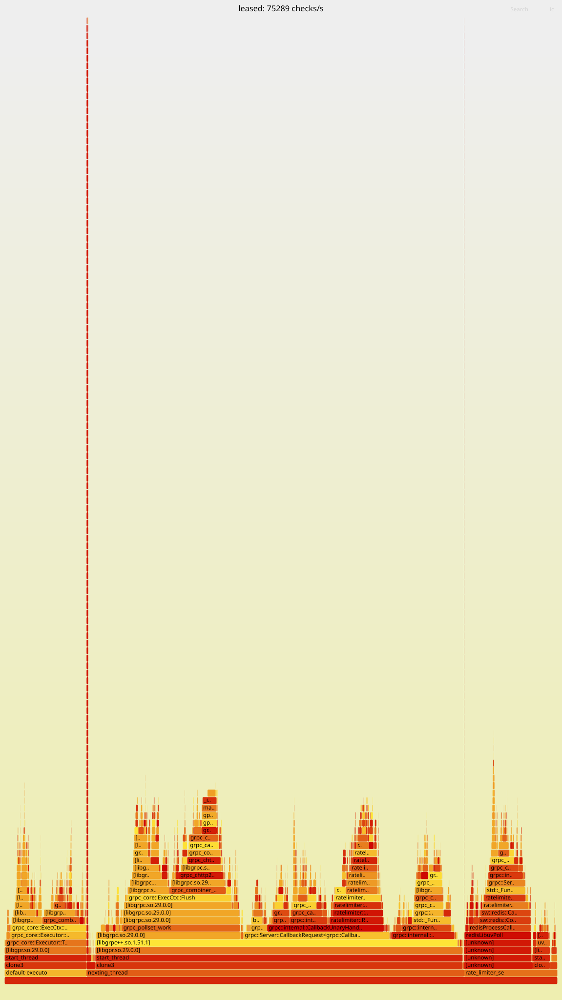

# Chapter 5. Evaluation

> Draft, started Week 7 (2026-10-24) from the Week 6 evidence. Target 12 to 14 pages. The benchmark
> matrix and the ablation are marked **[Pending: Week 7]**; the final extrapolation **[Pending: Week 8]**.

This chapter tests the two halves of the thesis claim separately, as Chapter 1 set out. First
correctness: quotas are exact under concurrency, retries, plan changes and failures (5.2 to 5.4).
Then cost: what the leased design buys in throughput and latency, and what it costs in accuracy and
isolation (5.5 to 5.10). Every number comes from a script in the repository, and every table names
its evidence file in `docs/thesis/evidence/`.

## 5.1 Setup

| Item | Value |
| --- | --- |
| Machine | laptop, Intel Core i5-12450H (8 cores, 12 hardware threads), 7 GB of RAM given to WSL2 |
| System | Ubuntu 24.04 in WSL2 (kernel 6.6.114.1-microsoft-standard-WSL2), gcc 13.3, `-O3 -march=native` |
| Redis | 7.4.11 in Docker 28.5.1: a development cluster of 3 masters; for fault tests, 3 masters with one replica each; no persistence |
| Limiter | the `release` build at the commit named in each evidence file, defaults unless stated |
| Load | `bench/loadgen` (C++, gRPC callback API): closed loop at a fixed number of calls in flight, or open loop at a fixed rate with latency from each call's scheduled time; Python clients for the accuracy tests |

The load generator, the limiter and Redis share one laptop. That bounds every throughput figure from
below: on separate machines each would have its own cores. It also makes the noise large, often ±10%
between runs, so the method follows from it.
- **Repetition:** every cell runs at least 3 times, usually 5, and 20 for quota accuracy; tables give the
  median with the range.
- **Comparisons:** builds or settings are compared in alternating runs within one session, never
  against a number from another day.
- **Isolation:** for the matrix, the servers and load generators are pinned to separate cores (`taskset`).
- **Extrapolation:** cluster-wide figures are labelled as estimates (5.12), never as measurements.

## 5.2 Quota accuracy (evaluation test 1)

**Setup.** `tests/eval/quota_accuracy.sh`:
- **Instances:** four limiter instances.
- **Customers:** one Free (200 a day) and one Pay (2,000 a day with a 10% grace, so 2,200). Their burst
  limits are raised so that the quota binds.
- **Load:** 400 and 4,400 calls of the `customer` rule, each with a request id, 64 in flight, spread
  over the instances.
- **Duplicates:** a tenth of the requests are sent twice at the same moment to two different
  instances. That is the hardest case for deduplication, because neither instance can know about the
  other's copy.
- **Repetition:** 20 runs.

**Result.** All 20 of 20 runs were exact. In every run three independent counts each equal the
allowance:
- the request ids that got an allowed answer;
- the counter in Redis;
- the usage events of the four instances.

The 96,000 requests included 9,608 sent twice at once, and none was counted twice. No request id got
an allowed answer from one instance and a denial from the other, and no call failed
(`quota_accuracy_2026-10-22.md`).

**Property tests.** Random histories go through the real engine on a transcription of the scripts,
under a fake clock. They mix checks, retries, plan changes, outages, clock jumps and UTC rollovers.
Each answer and usage event is compared with a reference model of Chapter 3's rules. 20,000 histories
per configuration gave 22.6 million checks, every one equal to the model. A second property bounds
leased quota for large plans. Over 80,490 simulated days, Redis never granted beyond the plan, and
what N instances admitted was what Redis granted, minus at most N × C units still held in leases.
The test catches bugs: ten planted in the engine one at a time were all caught
(`property_tests_2026-10-23.md`).

## 5.3 Plan changes, the reset and overage (evaluation tests 2 and 3)

- **Upgrades apply at once.** An upgrade written by the admin tool reached two instances 22 ms after
  the tool started (`PlanChangeIT`). The new limit applied on the next call and kept the day's usage.
- **A downgrade below today's usage** denies with `remaining = 0`, never a negative number
  (`QuotaDowngradeBelowUsageDeniesWithoutNegativeRemaining`).
- **One reset.** The day is derived from the Redis clock. The script tests cross a UTC midnight, and
  the property histories crossed 34,425 rollovers, including steps landing within ±1.5 s of the reset.
  The local denial ends exactly at the reset.
- **Request 2,001 gets three answers** under the three overage policies, through gRPC
  (`Request2001GivesThreeAnswersOnThreePolicies`):

  | Policy | Answer |
  | --- | --- |
  | hard | denied |
  | grace | allowed, free |
  | cap | allowed, billed as overage |

  The property histories produced 133,772 overage answers, all as the model predicted.

## 5.4 The burst accuracy bound and its model (evaluation tests 4 and 12)

**Setup.** `tests/eval/burst_accuracy.sh`:
- **Instances and key:** four instances serve one hot key of a leased bucket, 1,000 tokens refilled at
  100 a second.
- **Chunk caps:** 1%, 5% and 10% of the limit, so the worst case N × C is 40, 200 and 400 tokens.
- **Demand:** two shapes, at 2,000 calls a second in all:
  - a burst after an idle period, the worst case the proof allows;
  - steady overload.
- **Measure:** the over-admission is the largest excess, over any window, of what was admitted beyond
  what any exact bucket could admit.
- **Model:** a simulation of the protocol, written independently of the engine, replays the same
  calls.

*Figure 5.1: Over-admission against the chunk cap: measured (median of 5 runs), predicted, and the
worst case N × C (`burst_bound_2026-10-22.md`).*

| Cap | Worst case N × C | After idle: measured | model | Steady overload: measured |
| --- | --- | --- | --- | --- |
| 1% | 40 | 34.7 | 34.4 | −0.1 |
| 5% | 200 | 189.0 | 188.8 | −1.1 |
| 10% | 400 | 381.4 | 381.4 | −1.5 |

- **The bound holds and is tight.** Every run stayed below N × C. After an idle period the excess
  approaches it: each instance held a full lease, the bucket had refilled, and part of the refill
  landed within the window.
- **Under steady overload, leases cost no accuracy.** Over a whole run the leases admitted slightly
  fewer calls than an exact bucket would have.
- **The model predicts the system.** Measured and predicted values agree within 0.3 tokens, and the
  admitted counts are identical in 29 of 30 runs.

## 5.5 Floods and many customers (evaluation tests 5 and 6)

**A flood** (`flood_cardinality_2026-10-22.md`). A Free customer out of quota retried flat out, and
the instance denied it 74,881 times a second, its full rate for any check. Those denials cost Redis
2 calls in 10 seconds, both of them plan re-reads, because the deny cache answers locally. At a fixed
10,000 calls a second a denial took 0.24 ms at the median and 0.61 ms at p99.

**A million customers.**

| | 10,000 customers | 1,000,000 customers |
| --- | --- | --- |
| customer rule | 38,201 checks/s | 28,365 (−26%), 0.89 plan reads per check |
| leased rule | 72,902 checks/s | 47,320 (−35%), 0.62 refills per check, 224 MB of leases |

Redis memory per active customer is about 420 bytes: a plan of 171 bytes, plus a daily counter and a
burst bucket of 112 each by `MEMORY USAGE`. Uniform keys over a million customers are the hard case
for both caches: a customer's next call comes after its plan entry has expired, and a lease is used
about once. Skewed traffic, measured in 5.6, keeps both warm.

## 5.6 Strict against leased, and scaling (evaluation tests 7 and 8)

**Setup.** `bench/run_matrix.sh` covers:
- **Engines:** no limiter, strict, leased at three chunk caps, and the customer check.
- **Scale:** 1, 2 and 4 instances.
- **Keys:** uniform over a million keys, Zipf over a million keys, and one hot key.
- **Load:** closed loop at 192 calls in flight in all, 5 runs per cell; servers and load generators on
  separate cores.

The tables are generated by `tools/matrix_tables.py` from the 240 runs, none with a failed call
(`matrix_2026-10-24.md`).

*Table 5.x: Checks per second on one instance, median of 5 runs (p99).*

| Engine | Uniform, 1M keys | Zipf 0.99, 1M keys | One hot key |
| --- | --- | --- | --- |
| gRPC alone | 82,704 (5.5 ms) | | |
| strict | 42,065 (13.2 ms) | 40,571 (12.6 ms) | 18,386 (20.3 ms) |
| leased, cap 1% | 42,073 (12.6 ms) | 62,679 (7.2 ms) | 82,923 (6.0 ms) |
| leased, cap 5% | 38,984 (15.7 ms) | 66,931 (6.9 ms) | 95,605 (4.1 ms) |
| leased, cap 10% | 33,885 (17.9 ms) | 67,459 (6.9 ms) | 95,913 (3.9 ms) |
| customer check | 25,867 (15.7 ms) | 31,519 (13.2 ms) | (three states, below) |

**Leases pay exactly where keys repeat.**
- **Uniform keys over a million:** a run makes about 600,000 checks, so a key is seen less than once,
  nearly every check misses its lease, and leased equals strict.
- **Zipf:** leases add 55% to 66% and halve p99.
- **One hot key:** they reach 4.5 to 5.2 times strict, as fast as gRPC with no limiter within noise.
- **The chunk cap:** a larger cap is a little faster on repeated keys, because it needs fewer
  refills. It is the price of the tighter bound of 5.4; on uniform keys the caps differ within noise.

**The strict path's hot key is bound by one connection, not by Redis.** One instance sends a key's
calls through one client, with one connection and one I/O thread: 18,386 checks a second. Two
instances reach 46,283 on the same master.

**Instances.** The instances share the 192 calls in flight and the 6 server CPUs, so on one laptop
more instances cannot add capacity:
- **Two instances** beat one on most cells (gRPC alone: 82,704 to 108,946), because one process does
  not fill its 6 CPUs.
- **Four** lose again (98,419).
- **No engine degrades with N beyond that,** except the customer check, which loses 28% from 1 to 4
  instances against strict's 12%. A likely cause, not measured: each instance has its own plan cache,
  so each sees a customer 1/N as often.

Capacity with more machines is estimated in 5.11, not measured.

**Latency at fixed rates** (`bench/open_loop.sh`, open loop: latency from each call's scheduled
time; `open_loop_2026-10-24.md`):

| Rule | 10,000/s | 20,000/s | 30,000/s | 40,000/s |
| --- | --- | --- | --- | --- |
| leased `api_default`, p99 | 0.58 ms | 1.45 ms | 2.54 ms | 3.30 ms |
| customer check (Pay), p99 | 2.54 ms | 7.84 ms | | |

At the Week 5 gate a leased check queued beyond 20,000 offered (p99 156 ms at 30,000). The knee is now
beyond 40,000, consistent with the throughput gained since (5.10). A leased check stays under 1 ms at
p99 at 10,000 a second, against the 2 ms target of Chapter 3.

**The customer check on one hot key measured three states of one customer**, whose quota carried over
between runs:
- **Over its burst, within quota:** 14,365 checks a second, every call a burst script on one master.
- **Crossing the quota.**
- **Out of quota:** 84,106 to 90,754, answered by the deny cache.

In the crossing run the client counted about 30,000 allowed answers in 12 s, while Redis counted
exactly the plan's 2,200 for the day. By the code, the only uncounted allowed answer is the paid
plan's fail-open (`UNVERIFIED`), so Redis most likely stalled during that run. Metrics were off and
the stall itself was not observed. Eleven repeats crossing the quota, eight with metrics, were exact,
with no deadline misses. The load generator now counts `UNVERIFIED` answers, so the matrix records
any such run.

## 5.7 Faults (evaluation test 9)

`tests/eval/faults.sh` and `bench/fault_kill_master.sh` (`faults_2026-10-23.md`). Each fault is
measured before, during and after, with Free, Pay and leased streams. Their rates are 1,000, 5,000
and 10,000 checks a second.

| Fault | What each plan got | Recovery |
| --- | --- | --- |
| +20 ms on every master (below the 50 ms timeout) | nothing failed; customer checks p50 1.45 → 42.5 ms (two round trips); leased checks 0.61 → 0.64 ms | at once |
| +80 ms on one master | its third of the customers: Free `UNAVAILABLE`, Pay `UNVERIFIED`, at p99 under 4 ms; leases served until dry | within 1 s |
| one master silent (replies lost) | the same | before the next phase |
| every connection killed 5 times in 10 s | 2 to 18 calls followed the policy (those in flight); subscription back in 0.5 s | at once |
| a master killed, replica promoted | a third of the customers got their policy for 4 to 5 s | 4 to 5 s |

No call failed in any fault run. The test also found a fault in the design. The Redis client's
timeout is an idle timeout per connection, so before the fix a master 80 ms slow under load was never
timed out: checks succeeded after about 250 ms, with no fallback. Each Redis attempt now has its own
deadline.

## 5.8 A noisy neighbour (evaluation test 11)

Other tenants ran at 5,000 checks a second while one tenant sent 20,000 a second
(`noisy_neighbour_2026-10-23.md`).

| Noisy tenant | Others' p99 | Redis calls a second on its master |
| --- | --- | --- |
| none | 4.5 ms | 3,319 |
| over its daily quota | 14.4 ms | 3,319 |
| over its burst, within quota | 31.4 ms | 25,233 |

The others' answers stayed correct in every run.
- **Over quota:** the flood cost Redis nothing; the latency rise is shared CPU on the laptop.
- **Over burst:** each call ran the burst script, and that is the isolation gap the design leaves
  open (3.6.1).

## 5.9 Ablation (evaluation test 10)

`bench/ablation.sh` switches one mechanism off at a time and compares it with the full system in
alternating runs, on the workload where it should matter (5 runs each, one instance, Zipf keys;
`ablation_2026-10-24.md`).

*Table 5.y: Throughput without each mechanism.*

| Mechanism | Workload | Full system | Without it | Change |
| --- | --- | --- | --- | --- |
| lease | `api_default`, 1M keys | 73,172 checks/s, p99 6.05 ms | 51,434, 8.55 ms | **−29.7%** |
| deny cache | Free customers out of quota | 98,128, 3.92 ms | 34,706, 13.78 ms | **−64.6%** |
| plan cache | Pay customers | 42,232, 10.17 ms | 34,148, 11.09 ms | **−19.1%** |
| early refill | `api_default`, 1M keys | 74,571, 5.79 ms | 73,927, 5.79 ms | noise |
| adaptive chunk | same | 73,715, 6.05 ms | 74,768, 5.79 ms | noise |
| cache-line alignment | same | 73,208, 6.05 ms | 74,904, 6.05 ms | noise |
| batcher (on, against the default off) | strict path | 51,457, 7.84 ms | 50,984, 8.93 ms | noise |

**Three mechanisms carry the throughput:**
- the lease;
- the deny cache, which answers a customer out of quota locally;
- the plan cache.

**The other four have no measurable effect on one instance's throughput.** That is not what they are for:
- *Early refill* serves latency when a lease is about to run dry.
- *The adaptive chunk* serves accuracy and limits stranded tokens.
- *Alignment* is 14 times faster in the lease microbenchmark at 16 threads, but in the server each
  check also pays for gRPC, which hides it.
- *The batcher* gained nothing in Week 3 either, and stays off.

**A first deny-cache run measured nothing.** A Free customer's burst of 2 a second cannot reach its
quota of 200 within a run, so the cache never acted. The run above starts every Free customer out of
quota: an ablation is only as good as its workload.

## 5.10 Profiling and speed-ups

**The final build's profile** (`bench/profile.sh`, `profile_2026-10-24.md`; Figure 5.2) was taken with
`perf` at 999 Hz with frame-pointer stacks, under the closed loop on one instance.

| Self time | Leased rule (75,289 checks/s) | Customer rule (39,933) |
| --- | --- | --- |
| gRPC | 53.3% | 39.6% |
| allocation | 15.9% | 20.3% |
| Redis client | 4.3% | 8.6% |
| the limiter's own code | 4.1% | 6.3% |

*Figure 5.2: Where a leased check's CPU goes (`figures/profile_leased.svg`; the customer rule's
is `profile_customer.svg`).*

**The limiter's own code is a small part of the cost.** gRPC takes the largest share, plus most of
the allocation and all the locks. Allocation is spread thin:
- gRPC's per-call arena is the largest single caller, at 2.8%.
- This project's code allocates about 3% on the customer path and nothing on the lease path beyond
  gRPC's own.

So the remaining speed-up lies in fewer gRPC calls per check (`CheckBatch`), not in the engine.

**The one large finding came from the same method, the day before:** abseil's mutex deadlock
detection, running in gRPC's own threads. Switching it off gave:

| Workload | Before | After | Change |
| --- | --- | --- | --- |
| leased rule | 72,097 checks/s | 89,743 | +24.5% |
| customer rule | 36,469 | 41,654 | +14.2% |
| gRPC alone | 74,733 | 91,154 | +22.0% |

**Smaller results:**
- A lock-free per-attempt deadline queue took a Redis call through the resilient layer from 448 to
  214 ns.
- LTO, a larger glibc thread cache and jemalloc changed throughput within noise, so none is adopted.
- PGO was not tried: like LTO it rebuilds only the project's code, 4 to 6% of the CPU.

## 5.11 Extrapolation to 1,000,000 checks per second

Section 3.8 derives the estimate. It needs 12 to 50 instances for leased rules, depending on the
latency target, and 9 to 17 Redis masters for customer checks, from per-instance and per-master
measurements. The final figures, with the matrix's scaling data, are **[Pending: Week 8]**. They are
estimates, and labelled as such.

## 5.12 Discussion and threats to validity

**What the numbers support.**
- Quotas are exact: 20 of 20 adversarial runs on four instances, and 22.6 million checks equal to a
  model.
- The lease's over-admission is bounded by N × C. The bound is reached only after an idle period, and
  it is predicted by an independent model.
- Where keys repeat, a lease hit costs about 2% over gRPC with no limiter. Where keys almost never
  repeat, a lease gains nothing over strict (5.6).
- Failures degrade per plan, as documented, without failed calls.

**What they do not support yet.**
- **Absolute throughput on server hardware.** The load generator shares the laptop.
- **Scaling with instances.** On one laptop the instances share the CPUs, so the matrix shows only
  that no engine degrades with N (5.6).
- **Behaviour under real network latency.** The 20 ms test is a proxy for it.

**Threats to validity.**
- **One laptop.** Client, limiter and Redis compete for the same cores, so throughput is a lower bound
  and the noise is large. Comparisons are therefore made in alternating runs.
- **Docker networking on loopback.** Real round trips are longer, and they hurt the exact path more
  than the leased one (5.7).
- **The fake Redis of the property tests** is a transcription of the scripts. The scripts themselves
  are tested against a real Redis.
- **Uniform and Zipf keys are models of traffic,** not traces of real traffic.
