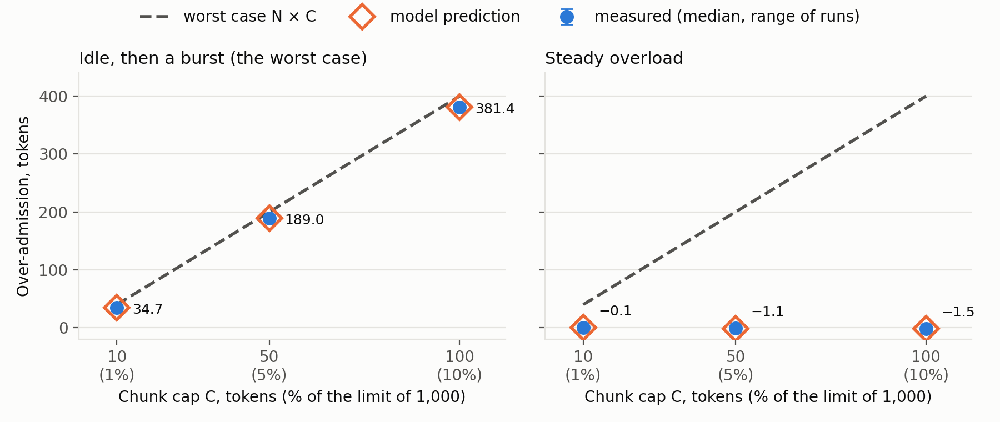
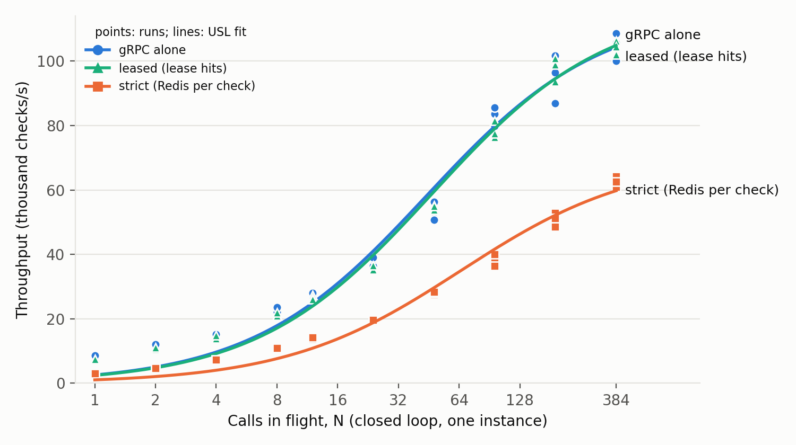
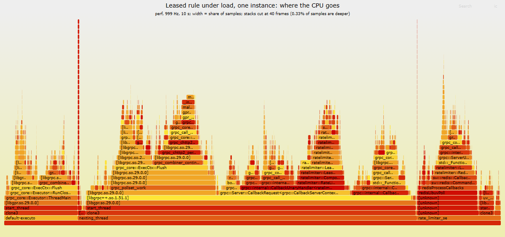

# Chapter 5. Evaluation

This chapter tests the two halves of the thesis claim separately, as Chapter 1 set out. First
correctness: quotas are exact under concurrency, retries, plan changes and failures (5.2 to 5.4).
Then cost: what the leased design buys in throughput and latency, and what it costs in accuracy and
isolation (5.5 to 5.10). Then merchants: isolation, changes, billing, the spending cap, capacity, scale
and the cost of tenancy (5.12). Every number comes from a script in the repository, and every table names
its evidence file in `docs/thesis/evidence/`.

## 5.1 Setup

*Table 5.1: The test setup.*

| Item | Value |
| --- | --- |
| Machine | laptop, Intel Core i5-12450H (8 cores, 12 hardware threads), 7 GB of RAM given to WSL2 |
| System | Ubuntu 24.04 in WSL2 (kernel 6.6.114.1-microsoft-standard-WSL2), gcc 13.3, `-O3 -march=native` |
| Redis | 7.4.11 in Docker 28.5.1: a development cluster of 3 masters; for fault tests, 3 masters with one replica each; no persistence |
| Limiter | the `release` build at the commit named in each evidence file, defaults unless stated |
| Load | `bench/loadgen` (C++, gRPC callback API): closed loop at a fixed number of calls in flight, or open loop at a fixed rate with latency from each call's scheduled time; Python clients for the accuracy tests |

The load generator, the limiter and Redis share one laptop. That bounds every throughput figure from
below: on separate machines each would have its own cores. It also makes the noise large, often ±10%
between runs, so the method follows from it.
- **Repetition:** every cell runs at least 3 times, usually 5, and 20 for quota accuracy; tables give the
  median with the range.
- **Comparisons:** builds or settings are compared in alternating runs within one session, never
  against a number from another day.
- **Isolation:** for the matrix, the servers and load generators are pinned to separate cores (`taskset`).
- **Extrapolation:** cluster-wide figures are labelled as estimates (5.13), never as measurements.

## 5.2 Quota accuracy (evaluation test 1)

**Setup.** `tests/eval/quota_accuracy.sh`:
- **Instances:** four limiter instances.
- **Customers:** one Free (200 a day) and one Pay (2,000 a day with a 10% grace, so 2,200). Their burst
  limits are raised so that the quota binds.
- **Load:** 400 and 4,400 calls of the `customer` rule, each with a request id, 64 in flight, spread
  over the instances.
- **Duplicates:** a tenth of the requests are sent twice at the same moment to two different
  instances. That is the hardest case for deduplication, because neither instance can know about the
  other's copy.
- **Repetition:** 20 runs.

**Result.** All 20 of 20 runs were exact. In every run three independent counts each equal the
allowance:
- the request ids that got an allowed answer;
- the counter in Redis;
- the usage events of the four instances.

The 96,000 requests included 9,608 sent twice at once, and none was counted twice. No request id got
an allowed answer from one instance and a denial from the other, and no call failed
(`quota_accuracy_2026-10-22.md`).

**Property tests.** Random histories go through the real engine on a transcription of the scripts,
under a fake clock. They mix checks, retries, plan changes, outages, clock jumps and UTC rollovers.
Each answer and usage event is compared with a reference model of Chapter 3's rules. 20,000 histories
per configuration gave 22.6 million checks, every one equal to the model. A second property bounds
leased quota for large plans. Over 80,490 simulated days, Redis never granted beyond the plan, and
what N instances admitted was what Redis granted, minus at most N × C units still held in leases.
The test catches bugs: ten planted in the engine one at a time were all caught
(`property_tests_2026-10-23.md`).

## 5.3 Plan changes, the reset and overage (evaluation tests 2 and 3)

- **Upgrades apply at once.** An upgrade written by the admin tool reached two instances 22 ms after
  the tool started (`PlanChangeIT`). The new limit applied on the next call and kept the day's usage.
- **A downgrade below today's usage** denies with `remaining = 0`, never a negative number
  (`QuotaDowngradeBelowUsageDeniesWithoutNegativeRemaining`).
- **One reset.** The day is derived from the Redis clock. The script tests cross a UTC midnight, and
  the property histories crossed 34,425 rollovers, including steps landing within ±1.5 s of the reset.
  The local denial ends exactly at the reset.
- **Request 2,001 gets three answers** under the three overage policies, through gRPC
  (`Request2001GivesThreeAnswersOnThreePolicies`):

  | Policy | Answer |
  | --- | --- |
  | hard | denied |
  | grace | allowed, free |
  | cap | allowed, billed as overage |

  The property histories produced 133,772 overage answers, all as the model predicted.

## 5.4 The burst accuracy bound and its model (evaluation tests 4 and 12)

**Setup.** `tests/eval/burst_accuracy.sh`:
- **Instances and key:** four instances serve one hot key of a leased bucket, 1,000 tokens refilled at
  100 a second.
- **Chunk caps:** 1%, 5% and 10% of the limit, so the worst case N × C is 40, 200 and 400 tokens.
- **Demand:** two shapes, at 2,000 calls a second in all:
  - a burst after an idle period, the worst case the proof allows;
  - steady overload.
- **Measure:** the over-admission is the largest excess, over any window, of what was admitted beyond
  what any exact bucket could admit.
- **Model:** a simulation of the protocol, written independently of the engine, replays the same
  calls.

*Figure 5.1: Over-admission against the chunk cap: measured (median of 5 runs), predicted, and the
worst case N × C (`burst_bound_2026-10-22.md`).*

*Table 5.2: Over-admission in tokens, median of 5 runs, against the worst case and the model.*

| Cap | Worst case N × C | After idle: measured | model | Steady overload: measured |
| --- | --- | --- | --- | --- |
| 1% | 40 | 34.7 | 34.4 | −0.1 |
| 5% | 200 | 189.0 | 188.8 | −1.1 |
| 10% | 400 | 381.4 | 381.4 | −1.5 |

- **The bound holds and is tight.** Every run stayed below N × C. After an idle period the excess
  approaches it: each instance held a full lease, the bucket had refilled, and part of the refill
  landed within the window.
- **Under steady overload, leases cost no accuracy.** Over a whole run the leases admitted slightly
  fewer calls than an exact bucket would have.
- **The model predicts the system.** Measured and predicted values agree within 0.3 tokens, and the
  admitted counts are identical in 29 of 30 runs.

## 5.5 Floods and many customers (evaluation tests 5 and 6)

**A flood** (`flood_cardinality_2026-10-22.md`). A Free customer out of quota retried flat out, and
the instance denied it 74,881 times a second, its full rate for any check. Those denials cost Redis
2 calls in 10 seconds, both of them plan re-reads, because the deny cache answers locally. At a fixed
10,000 calls a second a denial took 0.24 ms at the median and 0.61 ms at p99.

**A million customers.**

*Table 5.3: One instance over 10,000 and 1,000,000 customers.*

| | 10,000 customers | 1,000,000 customers |
| --- | --- | --- |
| customer rule | 38,201 checks/s | 28,365 (−26%), 0.89 plan reads per check |
| leased rule | 72,902 checks/s | 47,320 (−35%), 0.62 refills per check, 224 MB of leases |

Redis memory per active customer is about 420 bytes: a plan of 171 bytes, plus a daily counter and a
burst bucket of 112 each by `MEMORY USAGE`. Uniform keys over a million customers are the hard case
for both caches: a customer's next call comes after its plan entry has expired, and a lease is used
about once. Skewed traffic, measured in 5.6, keeps both warm.

## 5.6 Strict against leased, and scaling (evaluation tests 7 and 8)

**Setup.** `bench/run_matrix.sh` covers:
- **Engines:** no limiter, strict, leased at three chunk caps, and the customer check.
- **Scale:** 1, 2 and 4 instances.
- **Keys:** uniform over a million keys, Zipf over a million keys (exponent 0.99, as YCSB [24]), and
  one hot key.
- **Load:** closed loop at 192 calls in flight in all, 5 runs per cell; servers and load generators on
  separate cores.

The tables are generated by `tools/matrix_tables.py` from the 240 runs, none with a failed call
(`matrix_2026-10-24.md`).

*Table 5.4: Checks per second on one instance, median of 5 runs (p99).*

| Engine | Uniform, 1M keys | Zipf 0.99, 1M keys | One hot key |
| --- | --- | --- | --- |
| gRPC alone | 82,704 (5.5 ms) | | |
| strict | 42,065 (13.2 ms) | 40,571 (12.6 ms) | 18,386 (20.3 ms) |
| leased, cap 1% | 42,073 (12.6 ms) | 62,679 (7.2 ms) | 82,923 (6.0 ms) |
| leased, cap 5% | 38,984 (15.7 ms) | 66,931 (6.9 ms) | 95,605 (4.1 ms) |
| leased, cap 10% | 33,885 (17.9 ms) | 67,459 (6.9 ms) | 95,913 (3.9 ms) |
| customer check | 25,867 (15.7 ms) | 31,519 (13.2 ms) | (three states, below) |

**Leases pay exactly where keys repeat.**
- **Uniform keys over a million:** a run makes about 600,000 checks, so a key is seen less than once,
  nearly every check misses its lease, and leased equals strict.
- **Zipf:** leases add 55% to 66% and halve p99.
- **One hot key:** they reach 4.5 to 5.2 times strict, as fast as gRPC with no limiter within noise.
- **The chunk cap:** a larger cap is a little faster on repeated keys, because it needs fewer
  refills. It is the price of the tighter bound of 5.4; on uniform keys the caps differ within noise.

**The strict path's hot key is bound by one connection, not by Redis.** One instance sends a key's
calls through one client, with one connection and one I/O thread: 18,386 checks a second. Two
instances reach 46,283 on the same master.

**Instances.** The instances share the 192 calls in flight and the 6 server CPUs, so on one laptop
more instances cannot add capacity:
- **Two instances** beat one on most cells (gRPC alone: 82,704 to 108,946), because one process does
  not fill its 6 CPUs.
- **Four** lose again (98,419).
- **No engine degrades with N beyond that,** except the customer check, which loses 28% from 1 to 4
  instances against strict's 12%. A likely cause, not measured: each instance has its own plan cache,
  so each sees a customer 1/N as often.

Capacity with more machines is estimated in 5.11, not measured.

**Latency at fixed rates** (`bench/open_loop.sh`, open loop: latency from each call's scheduled
time; `open_loop_2026-10-24.md`):

*Table 5.5: p99 latency at fixed arrival rates, open loop, one instance.*

| Rule | 10,000/s | 20,000/s | 30,000/s | 40,000/s |
| --- | --- | --- | --- | --- |
| leased `api_default`, p99 | 0.58 ms | 1.45 ms | 2.54 ms | 3.30 ms |
| customer check (Pay), p99 | 2.54 ms | 7.84 ms | | |

On an earlier build (2026-10-21) a leased check queued beyond 20,000 offered (p99 156 ms at 30,000). The knee is now
beyond 40,000, consistent with the throughput gained since (5.10). A leased check stays under 1 ms at
p99 at 10,000 a second, against the 2 ms target of Chapter 3.

**The customer check on one hot key measured three states of one customer**, whose quota carried over
between runs:
- **Over its burst, within quota:** 14,365 checks a second, every call a burst script on one master.
- **Crossing the quota.**
- **Out of quota:** 84,106 to 90,754, answered by the deny cache.

In the crossing run the client counted about 30,000 allowed answers in 12 s, while Redis counted
exactly the plan's 2,200 for the day. By the code, the only uncounted allowed answer is the paid
plan's fail-open (`UNVERIFIED`), so Redis most likely stalled during that run. Metrics were off and
the stall itself was not observed. Eleven repeats crossing the quota, eight with metrics, were exact,
with no deadline misses. The load generator now counts `UNVERIFIED` answers, so the matrix records
any such run.

**One instance under rising concurrency** (`bench/concurrency_sweep.sh`, `scaling_2026-10-24.md`;
Figure 5.2). Closed loop from 1 to 384 calls in flight, 3 runs each:
- **Throughput never fell as concurrency rose.** Every median is above the one before.
- **The leased engine follows gRPC alone at every point** (104,581 against 105,626 checks/s at 384).
- **The strict engine levels off near 62,500**, each check waiting for a Redis round trip.

*Figure 5.2: Throughput of one instance against calls in flight, with Universal Scalability Law fits.*

**The Universal Scalability Law [23] does not describe this curve.**
- **Least squares** fits the plateau (R² 0.98, κ about 0, so no retrograde region) but puts the rate
  at one call in flight at a third of the measured one.
- **A fit on relative error** misses the plateau by up to 49%.
- **The likely reason:** the USL assumes a constant cost per request, while here the cost per call
  falls as calls pile up, since gRPC and the Redis client send more calls per write and per wake-up.

So the fit gives no projection beyond what the plateau already shows. Little's law [22] holds in all 30
cells: calls in flight ÷ throughput, the mean latency, lies between the measured p50 and p99. So the
load generator's latencies account for the whole time a call is out.

## 5.7 Faults (evaluation test 9)

`tests/eval/faults.sh` and `bench/fault_kill_master.sh` (`faults_2026-10-23.md`). Each fault is
measured before, during and after, with Free, Pay and leased streams. Their rates are 1,000, 5,000
and 10,000 checks a second.

*Table 5.6: Faults, and what each plan got.*

| Fault | What each plan got | Recovery |
| --- | --- | --- |
| +20 ms on every master (below the 50 ms timeout) | nothing failed; customer checks p50 1.45 → 42.5 ms (two round trips); leased checks 0.61 → 0.64 ms | at once |
| +80 ms on one master | its third of the customers: Free `UNAVAILABLE`, Pay `UNVERIFIED`, at p99 under 4 ms; leases served until dry | within 1 s |
| one master silent (replies lost) | the same | before the next phase |
| every connection killed 5 times in 10 s | 2 to 18 calls followed the policy (those in flight); subscription back in 0.5 s | at once |
| a master killed, replica promoted | a third of the customers got their policy for 4 to 5 s | 4 to 5 s |

No call failed in any fault run. The test also found a fault in the design. The Redis client's
timeout is an idle timeout per connection, so before the fix a master 80 ms slow under load was never
timed out: checks succeeded after about 250 ms, with no fallback. Each Redis attempt now has its own
deadline.

## 5.8 A noisy neighbour (evaluation test 11)

Other tenants ran at 5,000 checks a second while one tenant sent 20,000 a second
(`noisy_neighbour_2026-10-23.md`).

*Table 5.7: One noisy tenant and everyone else.*

| Noisy tenant | Others' p99 | Redis calls a second on its master |
| --- | --- | --- |
| none | 4.5 ms | 3,319 |
| over its daily quota | 14.4 ms | 3,319 |
| over its burst, within quota | 31.4 ms | 25,233 |

The others' answers stayed correct in every run.
- **Over quota:** the flood cost Redis nothing; the latency rise is shared CPU on the laptop.
- **Over burst:** each call ran the burst script, and that is the isolation gap the design leaves
  open (3.6.1).

## 5.9 Ablation (evaluation test 10)

`bench/ablation.sh` switches one mechanism off at a time and compares it with the full system in
alternating runs, on the workload where it should matter (5 runs each, one instance, Zipf keys;
`ablation_2026-10-24.md`).

*Table 5.8: Throughput without each mechanism.*

| Mechanism | Workload | Full system | Without it | Change |
| --- | --- | --- | --- | --- |
| lease | `api_default`, 1M keys | 73,172 checks/s, p99 6.05 ms | 51,434, 8.55 ms | **−29.7%** |
| deny cache | Free customers out of quota | 98,128, 3.92 ms | 34,706, 13.78 ms | **−64.6%** |
| plan cache | Pay customers | 42,232, 10.17 ms | 34,148, 11.09 ms | **−19.1%** |
| early refill | `api_default`, 1M keys | 74,571, 5.79 ms | 73,927, 5.79 ms | noise |
| adaptive chunk | same | 73,715, 6.05 ms | 74,768, 5.79 ms | noise |
| cache-line alignment | same | 73,208, 6.05 ms | 74,904, 6.05 ms | noise |
| batcher (on, against the default off) | strict path | 51,457, 7.84 ms | 50,984, 8.93 ms | noise |

**Three mechanisms carry the throughput:**
- the lease;
- the deny cache, which answers a customer out of quota locally;
- the plan cache.

**The other four have no measurable effect on one instance's throughput.** That is not what they are for:
- *Early refill* serves latency when a lease is about to run dry.
- *The adaptive chunk* serves accuracy and limits stranded tokens.
- *Alignment* is 14 times faster in the lease microbenchmark at 16 threads, but in the server each
  check also pays for gRPC, which hides it.
- *The batcher* gained nothing in an earlier comparison either (4.3), and stays off.

**A first deny-cache run measured nothing.** A Free customer's burst of 2 a second cannot reach its
quota of 200 within a run, so the cache never acted. The run above starts every Free customer out of
quota: an ablation is only as good as its workload.

## 5.10 Profiling and speed-ups

**The final build's profile** (`bench/profile.sh`, `profile_2026-10-24.md`; Figure 5.3) was taken with
`perf` at 999 Hz with frame-pointer stacks, under the closed loop on one instance, and drawn as a flame
graph [25].

*Table 5.9: Self time by category under load (perf, 10 s).*

| Self time | Leased rule (75,289 checks/s) | Customer rule (39,933) |
| --- | --- | --- |
| gRPC | 53.3% | 39.6% |
| allocation | 15.9% | 20.3% |
| Redis client | 4.3% | 8.6% |
| the limiter's own code | 4.1% | 6.3% |

*Figure 5.3: Where a leased check's CPU goes. Each bar is a function, its width the share of samples;
stacks are cut at 40 frames, which changes no width (0.33% of samples are deeper). The interactive
versions are `figures/profile_leased.svg` and `figures/profile_customer.svg`.*

**The limiter's own code is a small part of the cost.** gRPC takes the largest share, plus most of
the allocation and all the locks. Allocation is spread thin:
- gRPC's per-call arena is the largest single caller, at 2.8%.
- This project's code allocates about 3% on the customer path and nothing on the lease path beyond
  gRPC's own.

So the remaining speed-up lies in fewer gRPC calls per check, not in the engine. Measured:
`CheckBatch` with 10 checks per call reached 400,187 checks/s on one instance, 5.5 times single calls
on the same workload (`matrix_2026-10-24.md`).

**The one large finding came from the same method, the day before:** abseil's mutex deadlock
detection, running in gRPC's own threads. Switching it off gave:

*Table 5.10: abseil's mutex deadlock detection on and off, medians of 5 alternating runs.*

| Workload | Before | After | Change |
| --- | --- | --- | --- |
| leased rule | 72,097 checks/s | 89,743 | +24.5% |
| customer rule | 36,469 | 41,654 | +14.2% |
| gRPC alone | 74,733 | 91,154 | +22.0% |

**Smaller results:**
- A lock-free per-attempt deadline queue took a Redis call through the resilient layer from 448 to
  214 ns.
- LTO, a larger glibc thread cache and jemalloc changed throughput within noise, so none is adopted.
- PGO was not tried: like LTO it rebuilds only the project's code, 4 to 6% of the CPU.
- Redis Functions (`FCALL`) ran the same script at the same rate as `EVALSHA`, without and with
  pipelining (62,461 against 62,469 calls/s unpipelined).

## 5.11 Extrapolation to 1,000,000 checks per second

This section applies the model of Section 3.8 to the final measurements (`tools/extrapolate.py`, which
names the source of every input). Its outputs are **estimates, not measurements**: no cluster of that
size was run.

*Table 5.11: Redis masters at 1,000,000 checks per second, for traffic of one kind of check only; a
real mix lies between the rows. A master is taken to absorb 120,000 script calls a second.*

| All checks are | Redis calls per check | Calls/s | Masters at 120,000 |
| --- | --- | --- | --- |
| a leased rule, hot keys (10k active) | 0.017 | 17,000 | 1 |
| a leased rule, 1M keys (Zipf) | 0.217 | 217,000 | 2 |
| customer checks, enterprise plans (quota leased) | 1.017 | 1,017,000 | 9 |
| customer checks, Free and Pay, plans cached | 2 | 2,000,000 | 17 |
| customer checks, Free and Pay, worst case for the plan cache | 2.89 | 2,890,000 | 25 |

*Table 5.12: Limiter instances at 1,000,000 checks per second.*

| Operating point | Checks/s per instance | Instances |
| --- | --- | --- |
| leased rule, saturated (p99 about 7 ms) | 67,459 | 15 |
| leased rule, p99 below 2 ms (goal G6) | 20,000 | 50 |
| leased rule, CheckBatch of 10 | 400,187 | 3 |
| customer check, saturated (p99 about 13 ms) | 31,519 | 32 |
| customer check, at a rate answered in full (p99 7.8 ms) | 20,000 | 50 |

**Reading.**
- **Leased rules are cheap in Redis and bound by gRPC.**
  - *Redis:* one or two masters, even when a million keys are active.
  - *Instances:* 15 near saturation, or 50 to keep p99 under 2 ms. That is gRPC's cost per call,
    since the limiter's own code is 4 to 6% of the CPU (5.10).
  - *Batching:* with batches of 10, three instances would do.
- **The customer check is bound by Redis:**
  - two scripts per check, so 17 masters;
  - 25 if the plan cache is cold for every check. That worst case was measured at a million customers
    spread uniformly over one instance; with N instances the plan reads grow with N (3.8.2).
- **Leasing the burst limit per customer, the future work of 3.2.1,** would bring customer checks
  far below their limit towards the leased row.

**Cost.** Prices are AWS on-demand list prices, retrieved 2026-10-24 from instances.vantage.sh:
- c7i.2xlarge (8 vCPU), $0.357 an hour, for one limiter instance. The laptop gave each instance 6
  logical CPUs.
- cache.r7g.large (2 vCPU, 13 GiB), $0.219 an hour, for each Redis master and its one replica.

That an 8-vCPU cloud instance does what the laptop instance did, and a Graviton core what a laptop
core did, are further assumptions.

*Table 5.13: Monthly cost at 1,000,000 checks per second (estimate).*

| Deployment | Instances | Masters (+ replicas) | Per month | Per billion checks |
| --- | --- | --- | --- | --- |
| leased rule, p99 below 2 ms | 50 | 2 (+2) | $13,670 | $5.20 |
| leased rule, CheckBatch of 10 | 3 | 2 (+2) | $1,421 | $0.54 |
| customer checks, Free and Pay, answered in full | 50 | 17 (+17) | $18,466 | $7.03 |

**Reading the cost table.**
- **Most of the cost is limiter instances, that is, gRPC calls.** Batching ten checks per call cuts
  the leased deployment's cost by about ten times.
- **Memory fits.** If every call carries a request id, about 3 GB of stored answers falls on each of
  17 masters (3.8.2), which fits in 13 GiB.

**Assumptions** (3.8.4), with what the measurements added:
- *A server instance does at least what a laptop instance does.* In the matrix runs the load generator
  used 1.7 to 5.4 cores of the same laptop (5.6).
- *Instances scale linearly.* Not testable on one laptop. The matrix shows no engine degrading with up
  to four instances, and the USL fit of a single instance (below) shows where one instance saturates.
- *A master absorbs 120,000 script calls a second.* Redis Functions ran the same script at the same
  rate as `EVALSHA` (5.10), so the choice of command does not change it.

## 5.12 Merchants (G10 to G14)

The service was then evaluated with merchants (3.9), on the real limiter (`RL_TENANCY=merchants`, engine
`leased`) and the management API, on the development cluster unless stated (`p4_merchants_2026-10-28.md`).

**Isolation (G10).** Two merchants each had a customer named `cust-1`, on a plan of 5 calls a day. All
nine checks passed:
- *Separate customers:* A's customer was refused after its 5 calls, while B's was untouched.
- *Separate management:* each merchant's API showed only its own usage, and A's management key could
  neither see nor change B's customers.
- *No naming trick:* calls naming `shop-b|cust-1` under A's API key did not reach B's customer.
- *Keys:* an unknown key, and a revoked one, were refused at once.

With a planted bug that put every merchant's customers in one namespace, four of the nine failed. The
other five are decided by the API and the key index, which the bug does not touch.

**A noisy merchant (G10).** Evaluation test 11 (5.8) was repeated with merchants:
- *The others:* another merchant's 1,000 Pay customers at 5,000 checks a second.
- *The noisy merchant:* 20,000 calls a second to one customer.
- *Redis calls:* counted over all three masters. The others' own checks cost about 10,000 a second.

*Table 5.14: A noisy merchant and another merchant's customers (medians of 3 runs).*

| Noisy merchant's flood | Others' p50 | Others' p99 | Redis calls a second |
| --- | --- | --- | --- |
| none | 1.12 ms | 4.66 ms | 10,135 |
| unknown API key | 2.14 ms | 14.39 ms | 10,115 |
| over the operator's check rate | 1.65 ms | 3.76 ms | 10,281 |
| over its own capacity | 1.65 ms | 3.44 ms | 11,575 |
| over its customer's daily quota | 1.72 ms | 6.32 ms | 10,136 |
| over its customer's burst, within quota | 2.23 ms | 16.38 ms | 30,144 |

The others' calls were all answered and allowed, 50,000 of 50,000 in every run.
- **Four floods cost Redis little or nothing:** an unknown key, a flood over the check rate, over the
  capacity, or over the quota. The most was 1,440 calls a second above the baseline for 20,000 calls a
  second of flood, from lease refills of the capacity. The others' latency rose only where the limiter's
  CPU, shared with the load generators, answered 20,000 more calls a second.
- **A flood over a customer's burst still costs Redis:** one script per call, the gap of 5.8.
  - *The effect:* in one of three runs, 75 of the others' calls were answered by their plan's failure
    policy instead of a counted decision.
  - *The fix:* the operator's check rate, which holds Redis at its baseline.

**Fixed by this test: a flood over the capacity.**
- *What the first runs found:* each call over the capacity ran the customer's burst script, then
  returned its token. That was two Redis calls per refused call, and up to 277 of the other merchant's
  calls in a run were answered by their failure policy.
- *The change:* while Redis says the capacity is out, the call is refused from the lease alone, before
  the burst script (4.7).
- *Measured in alternating runs* (Table 5.15).
  - *Its cost on every check of a merchant with a capacity* (one more lease lookup): 32,567 checks a
    second before and 30,141 after. The ranges overlap, so no difference is shown within the laptop's
    noise.
  - *Its effect on the result:* nothing is admitted that was refused before, since the early refusal
    denies only what the lease would. The capacity property test gives the same totals with it.

*Table 5.15: A flood over a merchant's capacity, before and after the early refusal (3 alternating runs each).*

| Build | Redis calls a second | Others' p50 | Others' p99 |
| --- | --- | --- | --- |
| before | 41,655, 42,539, 42,342 | 5.09, 5.09, 4.47 ms | 44.38, 42.50, 44.38 ms |
| after | 12,489, 12,721, 12,072 | 2.44, 2.54, 2.05 ms | 12.63, 27.55, 14.39 ms |

**The latency of a change (G11).**
- *Setup:* two limiters and a background load of 10,000 checks a second.
- *Each change:* made through the management API. Then both limiters were checked in turn until each
  answered with it.
- *The customers:* a customer with a leased quota of 1,000,000 a day, and one held by the deny cache.

*Table 5.16: From the API's answer to both limiters enforcing a change (30 trials each).*

| Change | p50 | max | API call and propagation, max |
| --- | --- | --- | --- |
| suspend, resume | 2.19, 3.16 ms | 2.86, 4.02 ms | 13.3 ms |
| quota down (a leased quota), up | 3.74, 3.21 ms | 5.82, 4.92 ms | 15.9 ms |
| boost on (a customer denied), off | 4.09, 4.02 ms | 6.57, 5.52 ms | 14.9 ms |
| the merchant's capacity on, off | 1.20, 2.24 ms | 5.77, 4.93 ms | 14.6 ms |

- **Every change applied within 16 ms,** the API call included, against a goal of 1 s.
- **Plan changes left no stale answers:** once the API answered, neither limiter answered under the
  old terms, for a lowered leased quota too. The cached plan and denial are dropped on the message, and
  a lowered quota leaves the leased path (3.4.5).
- **A capacity change gave 1 or 2 old answers** in 10 of 60 trials, since it reaches the limiters by a
  reload of the merchant table rather than a cache drop.

**Billing exactness (G12).** The P3 gate was rerun on the final code: one merchant, 40 postpaid
customers, 1,500 calls a second for 20 s over two limiters, on the fault cluster (replicas, AOF). The
gateway retried with the same request id, and a master was killed 8 s in.

*Table 5.17: Invoices against the counters and the gateway's view (`tests/eval/billing_gate.py`).*

| Run | Calls | Told: in plan / overage | No decision after 6 tries | Counters and invoice: overage | Customers with a difference |
| --- | --- | --- | --- | --- | --- |
| no kill | 29,997 | 6,000 / 23,997 | 0 | 23,997 ($772.03 in all) | 0 |
| master 7106 killed | 29,999 | 6,000 / 23,184 | 815 | 23,184 ($771.60) | 0 |
| master 7105 killed | 29,996 | 6,000 / 23,744 | 252 | 23,744 ($771.90) | 0 |

**Every invoice equalled the counters, and the counters equalled what the gateway was told,** for
every customer in every run. Both limiters' usage events agreed too.
- *Lost calls:* a call that got no decision after 6 attempts was neither counted nor billed.
- *Not shown:* a killed master can still lose acknowledged increments that had not reached its replica
  (3.9.6). These runs did not catch such a write, which is not evidence that none can be lost.

**The spending cap (G13).**
- *The test:* the property tests ran 2,000 seeds per configuration, 571,482 checks each, every answer
  equal to a model of the rules. That included about 10,030 answers of billed overage and 2,661 customer
  months with billed overage per configuration.
- *Leases too:* the leased quota test found Redis granting nothing beyond the cap in 8,146 days.
- *It can fail:* a bug planted in the script's transcription, letting billed overage go one call past
  the cap, failed all four model tests at seed 2.

**Capacity and priority (G14).**
- *The merchant's capacity:* 1,000 calls a second, 30% reserved for plans with a fee.
- *The load:* a Free flood at 5,000 a second, and paying customers asking for 100 to 600 a second.

*Table 5.18: Calls admitted a second under a Free flood (medians of 3 runs, 10 s each).*

| Load | Free | Paid admitted / asked | Total |
| --- | --- | --- | --- |
| 1 limiter, paid 100 a second | 686.6 | 100.0 / 100 | 786.6 |
| 1 limiter, paid 300 a second | 656.4 | 300.0 / 300 | 956.4 |
| 1 limiter, paid 600 a second | 624.7 | 378.5 / 600 | 1,003.2 |
| 2 limiters, paid 300 a second | 654.9 | 300.0 / 300 | 954.9 |

- **The capacity held:** at most 1,003.2 calls a second over 10 s. The property test checks every window
  from 1 ms to 4 s against the capacity plus N × C, over 2,000 seeds; the fullest window reached 91% of
  its bound.
- **Free calls never took the reserve:** at most 687 a second of their 700.
- **Paying customers kept the reserve, and no more.** Asking for at most the reserve, they lost no call.
  Asking for 600, they got the 300 of the reserve plus about 78 from the shared part, where they compete
  with the Free calls.

**Many merchants.**
- *The setup:* 10,000 merchants of 100 customers each, a million plans, written as the API writes them.
- *Redis:* 193 bytes a customer, the merchant's key, catalogue and customer index included.
- *A limiter:* loaded the 10,000 keys and answered within 0.10 s of starting, and used 118 MiB after
  the load.
- *Throughput:* 25,749 calls a second with a random merchant and customer on each call. Nearly every call
  met a customer whose plan was not cached, so it paid a plan read besides its two scripts.
- *A new merchant:* its key worked 36.7 ms after it was announced.

**The cost of tenancy.** The customer cell of `bench/ab_compare.sh` was run in alternating runs of one
build: the customer rule over Zipf 10,000 Pay customers, without tenancy, with it, and with a capacity
and a check rate set too high to refuse.

*Table 5.19: The cost of tenancy (5 alternating runs each).*

| Variant | Checks a second, median (range) | Difference | p99 |
| --- | --- | --- | --- |
| without tenancy | 36,009 (31,631 to 38,240) | | 13.78 ms |
| with tenancy | 36,760 (25,243 to 37,483) | +2.1% | 11.59 ms |
| with tenancy, a capacity and a check rate | 34,614 (30,529 to 37,383) | −3.9% | 14.39 ms |

**Tenancy costs less than this setup can measure.** The differences are inside the laptop's noise,
and the last two runs were slower for every variant.
- *Per call:* the API key costs a hash-map lookup in the thread's cache.
- *Per check of a merchant with limits:* each of the merchant's buckets costs a lease hit.

**The portal and the demo.**
- *The portal:* a headless browser drove every action of the portal against the API, 22 of 22 checks
  (4.7).
- *Demo v2:* a Pay customer 30 calls past its quota was admitted as billed overage, and the invoice
  preview showed the charge. A Free flood at 800 calls a second was held to the merchant's capacity,
  while a paying customer kept all of its calls.

## 5.13 Discussion and threats to validity

**What the numbers support.**
- Quotas are exact: 20 of 20 adversarial runs on four instances, and 22.6 million checks equal to a
  model.
- The lease's over-admission is bounded by N × C. The bound is reached only after an idle period, and
  it is predicted by an independent model.
- Where keys repeat, a lease hit costs about 2% over gRPC with no limiter. Where keys almost never
  repeat, a lease gains nothing over strict (5.6).
- Failures degrade per plan, as documented, without failed calls.
- Merchants are isolated by name, and a flood that a merchant's own limits or the operator's check rate
  refuse costs the others almost nothing in Redis (5.12).
- A change made through the management API applies on two instances within 16 ms, and invoices equal
  the counters, also with a master killed (5.12).
- Tenancy costs less than the laptop's noise of ±10% (5.12).

**What they do not support yet.**
- **Absolute throughput on server hardware.** The load generator shares the laptop.
- **Scaling with instances.** On one laptop the instances share the CPUs, so the matrix shows only
  that no engine degrades with N (5.6).
- **Behaviour under real network latency.** The 20 ms test is a proxy for it.
- **Billing through any failover.** Three runs with a master killed lost nothing, but asynchronous
  replication can lose an acknowledged increment, and these runs show only that it was rare there.
- **Many instances for merchants.** The latency of a change and the capacity were measured on two; the
  bound for N instances rests on the property test.

**Threats to validity.**
- **One laptop.** Client, limiter and Redis compete for the same cores, so throughput is a lower bound
  and the noise is large. Comparisons are therefore made in alternating runs.
- **Docker networking on loopback.** Real round trips are longer, and they hurt the exact path more
  than the leased one (5.7).
- **The fake Redis of the property tests** is a transcription of the scripts. The scripts themselves
  are tested against a real Redis.
- **Uniform and Zipf keys are models of traffic,** not traces of real traffic.
